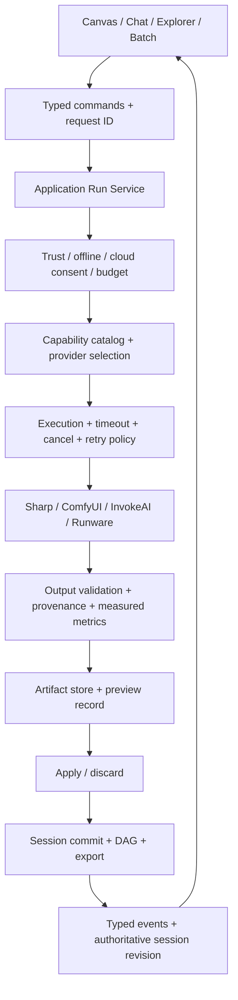

# Pixel Pilot — Đánh giá hệ thống và kế hoạch hoàn thiện

Ngày đánh giá: 05/11/2026, múi giờ Asia/Saigon.

## 1. Kết luận điều hành

Pixel Pilot có nền tảng của một **prototype nâng cao, đủ để thử nghiệm có hướng dẫn**, với định vị rõ: trợ lý xử lý tài nguyên ảnh ngay trong VS Code cho lập trình viên. Chưa đủ bằng chứng để kết luận sẵn sàng phát hành rộng rãi.

Giá trị đáng phát triển nhất là chuỗi công việc **mở ảnh trong dự án → chỉnh bằng công cụ hoặc hội thoại → so sánh → giữ kết quả/khôi phục → xuất đúng định dạng và dùng trong code**. DAG, session pinning, lưu artifact trước khi cập nhật lịch sử và khả năng chọn local/cloud là nền tảng phù hợp cho chuỗi này.

Ưu tiên hiện tại: khép kín các luồng chính và thống nhất thực thi. Việc thêm model tiếp theo chỉ hiệu quả khi mọi tác vụ đều có cùng cơ chế quyền, hủy, lưu kết quả, báo lỗi và chi phí.

### Phạm vi và mức chắc chắn

- Đã đọc mã nguồn Host, Webview, adapter, execution, lưu trữ, batch, CI, test và tài liệu nghiệm thu.
- Đã chạy `npm.cmd run lint`: PASS source-policy lint và Host/Webview type-check.
- Đã chạy `npm.cmd run check`: PASS build và **115/115 Node tests**, 0 fail, 0 skipped. Trong suite có 120 trường hợp đánh giá planner Việt/Anh.
- Các phát hiện dưới đây chủ yếu là kiểm tra mã nguồn; không phải lần kiểm thử tương tác đầy đủ trên VS Code.
- Không gọi API cloud, không đo chất lượng FLUX live, không kiểm tra trên máy/VM cài sạch trong lượt đánh giá này.
- Các chỉ tiêu và thời lượng ở phần kế hoạch là **mục tiêu đề xuất**, không phải kết quả đã đo.

## 2. Định vị sản phẩm và phạm vi phát hành đầu tiên

**Định vị đề xuất:** “AI Image Copilot cho lập trình viên — chuẩn bị và chỉnh tài nguyên ảnh ngay trong VS Code, có lịch sử khôi phục và kiểm soát local/cloud.”

Người dùng đầu tiên: frontend developer, indie developer và người phát triển game nhỏ đang xử lý icon, avatar, ảnh sản phẩm, banner và sprite trong repository.

| Luồng trọng tâm | Kết quả người dùng cần |
| --- | --- |
| Chuẩn bị asset | Tách nền, resize, nén WebP/PNG, đặt tên và xuất vào thư mục dự án |
| Chỉnh một đối tượng | Khoanh box hoặc tô mask, nhập yêu cầu, xem trước rồi chọn giữ/hủy |
| Tạo biến thể | Sinh ảnh hoặc đổi phong cách bằng provider khả dụng, lưu model/prompt/seed nếu provider hỗ trợ |
| Thử và khôi phục | So sánh node, rollback, tạo nhánh, mở lại phiên sau reload |
| Dùng trong code | Chèn đường dẫn/snippet phù hợp dự án, tránh ghi đè ngoài ý muốn |
| Xử lý nhiều ảnh | Lập danh sách, chọn thao tác/output, theo dõi từng ảnh, hủy và chạy lại mục lỗi |

OCR và image-to-code là tính năng mở rộng. Đặt chúng sau các luồng trọng tâm trong kế hoạch beta. Giới hạn Windows x64 cho đợt beta đầu tiên nếu đó là môi trường nhóm có thể nghiệm thu đầy đủ; chỉ công bố nền tảng khác sau khi có bằng chứng tương ứng.

## 3. Đánh giá theo thành phần

| Thành phần | Đánh giá | Việc còn thiếu |
| --- | --- | --- |
| Session và DAG | Nền tảng tốt: pin parent, branch, rollback, kiểm tra store và khôi phục khi ghi thất bại | Hoàn thiện preview/commit, kiểm thử đồng thời và phiên lớn |
| Bảo vệ dữ liệu | Có SecretStorage, PolicyService, trust/consent, kiểm tra MIME/SVG | Áp dụng đồng nhất trên mọi đường vào, đặc biệt batch |
| Điều phối công cụ | Có registry, contracts, orchestrator, execution engine | Nút UI, chat, batch và legacy còn có đường chạy riêng |
| Local/cloud | Có Sharp, ComfyUI, InvokeAI, Runware | Capability catalog chưa đại diện đầy đủ provider và tool |
| Canvas/UX | Có mask, zoom, DAG UI, component so sánh; FLUX box đã có mã tích hợp | Hoàn thiện trạng thái chạy, phím tắt, giữ vùng chọn, request ownership và preview thật |
| Chất lượng ảnh | Có model thật và artifact thực nghiệm local | Chưa có bộ đánh giá đại diện chứng minh chất lượng từng tác vụ |
| Kiểm thử | Build, 115 regression tests, CI Linux/Windows, activation smoke | Thiếu UI critical flows và kiểm chứng chất lượng đầu ra |
| Cài đặt/phát hành | Có VSIX, install smoke và tài liệu release gate | Clean-machine walkthrough, runtime compatibility, onboarding tự chẩn đoán |
| Tài liệu | Phong phú, có ghi rõ giới hạn ở README/release gate | Một số báo cáo UAT khẳng định rộng hơn evidence gốc |

## 4. Các phát hiện cần xử lý theo ưu tiên

### F01 — P0: batch có thể bỏ qua kiểm soát cloud/offline chung

[extension.ts](../src/extension.ts) chọn Runware khi ComfyUI offline và có key, sau đó gọi `BatchProcessor.executeBatch`. Đường này chưa đi qua `PolicyService.requireCloudConsent` hoặc kiểm tra offline chung. [BatchProcessor](../src/services/batch/BatchProcessor.ts) cũng trực tiếp gọi adapter và ghi output.

Hệ quả: cấu hình offline và quyền gửi ảnh không được bảo đảm đồng nhất giữa thao tác đơn và batch. Cần dùng chung policy, kiểm tra trước khi bắt đầu và ngay trước từng bước gửi cloud; xử lý trường hợp người dùng đổi chế độ hoặc hủy lô đang chạy. Khi từ chối phải không upload và không tạo output ngoài yêu cầu.

### F02 — P0: Preview chưa có giao dịch áp dụng/hủy hoàn chỉnh

[App.tsx](../webview-ui/src/App.tsx) nhận `previewReady`/`plan.preview_ready`, gửi `plan.apply`/`plan.discard` và tự báo thành công. Trong phần Host đã rà soát chưa thấy producer/handler tương ứng. Phần lớn thao tác hiện tại lưu/commit ngay.

Cần xác lập hai trạng thái: artifact xem trước và node đã áp dụng. Host sở hữu preview ID, parent revision và quyết định commit. Webview chỉ hiển thị “đã áp dụng” sau ACK thành công; lỗi ghi đĩa, preview hết hạn hoặc đổi parent phải có kết quả rõ ràng. Dùng node đã có để so sánh lịch sử cũng cần đường điều khiển riêng, không tái gọi provider.

### F03 — P0: phím tắt và vùng chọn có lỗi tương tác có thể suy ra từ mã

[Canvas.tsx](../webview-ui/src/components/Canvas.tsx) đặt `onKeyDown` trên container bao cả các input FLUX. Handler bắt B/E/0/+/- và không bỏ qua input, textarea, contenteditable hoặc IME; do đó có thể chặn ký tự khi người dùng gõ mô tả. Handler cũng gắn ở cả container ngoài và viewport; sự kiện có thể bubble qua hai handler. Inpaint gọi `clearMask()` ngay sau khi gửi, trước khi biết thành công.

Cần giới hạn phím tắt vào vùng canvas, bỏ qua trường nhập và IME, giữ mask/box/prompt khi fail hoặc deny; xóa khi người dùng chọn hoặc khi chuyển sang ảnh mới. Dùng Pointer Events và pointer capture để hoàn thiện thao tác kéo vùng chọn.

### F04 — P1: lifecycle, hủy và chống chạy trùng chưa bao phủ mọi tác vụ

`copilotRequest` dùng request ID, dedupe và lifecycle; `applyAction`, generate, upscale và FLUX box còn đường xử lý riêng trong [PixelPilotViewProvider](../src/providers/PixelPilotViewProvider.ts). FLUX box hiện không có request ID, cancellation xuyên suốt hoặc khóa gửi lặp riêng. [fetchWithTimeout](../src/utils/fetchWithTimeout.ts) tạo signal riêng và thay signal đầu vào, nên chưa thể dùng nguyên trạng để truyền hủy từ người dùng.

Cần một run service dùng chung, truyền AbortSignal tới adapter và chặn commit kết quả muộn. Timeout phải được phân biệt với người dùng hủy. Với cloud, hủy ở client không tự chứng minh provider đã dừng hoặc không tính phí. Không tự submit lại tác vụ có tính phí khi chưa biết lần gửi trước đã được nhận hay chưa.

### F05 — P1: capability và fallback chưa thống nhất với lời hứa của tool

[ProviderCatalog](../src/services/execution/ProviderCatalog.ts) mặc định mới đăng ký Sharp và một phần ComfyUI; Runware/InvokeAI chưa có probe được đăng ký trong mã đã rà soát. Các đường UI vẫn tự ping/chọn adapter.

[ComfyUIAdapter](../src/services/ai/ComfyUIAdapter.ts) có thể chuyển diffusion inpaint/outpaint/style sang local fill, viền đặc hoặc filter khi model lỗi. Fallback có tên trong metrics nhưng UI thường chỉ báo hoàn tất. Điều này chưa bảo đảm người dùng hiểu kết quả thuộc mức xử lý nào.

Cần khai báo capability theo task + mode + provider/model; probe phản ánh node/model/runtime thật. Cho chọn “AI model” hoặc “xử lý cơ bản”; chuyển mode phải được hiển thị rõ và tuân theo lựa chọn người dùng.

### F06 — P1: metrics và một số nhãn chức năng vượt quá dữ liệu thực

Nhiều adapter gán `latencyMs`/`costUsd` hằng số. FLUX đã yêu cầu chi phí từ response, nhưng khi thiếu giá trị vẫn gán 0. `PriorityToolRunService` cũng tạo metrics model=tool name, latency/cost=0, chưa truyền đầy đủ provenance từ provider.

[ImageProcessor.vectorize](../src/services/image/ImageProcessor.ts) thu ảnh về 48×64, lượng tử màu và dựng rect SVG; đây là một cách biểu diễn ảnh bằng hình chữ nhật, chưa phải tracing đường nét chất lượng cao. Caption fallback chỉ dùng metadata nhưng sinh nhận xét về chủ thể/độ tương phản. Các nhãn “SOTA”, “Super-Resolution” hoặc “AI” cần được đối chiếu đúng engine đã chạy.

Cần tách `actual/estimated/unknown` cho chi phí; đo thời gian thực; ghi provider/model/mode/seed khi biết. Caption không có model chỉ mô tả metadata. SVG giữ đúng tỉ lệ và công bố giới hạn; chỉ nâng thành vector tracing sau khi có engine và đánh giá đầu ra.

### F07 — P1: evidence và báo cáo chưa khớp phạm vi

[UAT](bao-cao-kiem-thu/01_BAO_CAO_KIEM_THU_NGUOI_DUNG.md) ghi 76/76 thực tế và 100% thành công. Tuy nhiên [local_provider_execution.json](../evals/release/local_provider_execution.json) tự giới hạn là runtime smoke trên fixture, không đánh giá chất lượng hoặc bảo vệ da. [evalRunner](../src/evals/copilot/evalRunner.ts) kiểm tra RulePlanner trên 120 golden cases; không gọi toàn bộ agent/model/UI.

[Extension Host smoke](../test/e2e/extensionHost.cjs) kiểm tra activation, command và mở Studio; không thao tác canvas hoặc xác nhận kết quả chỉnh ảnh. [Release evidence](COPILOT_RELEASE_EVIDENCE.md) đã ghi giới hạn này.

Cần ma trận mỗi claim → case → môi trường → log/artifact → người xác nhận; ghi rõ automatic fixture, runtime smoke, UI acceptance và quality evaluation. Không suy ra chất lượng ảnh hay khả năng agent thực từ tỷ lệ golden-case pass.

### F08 — P1/P2: lưu trữ và hiệu năng cần đo trước khi mở rộng

Đang cùng tồn tại [AssetStorageService](../src/services/storage/AssetStorageService.ts) và [ArtifactStore](../src/services/storage/ArtifactStore.ts); đường priority có thể tạo artifact rồi cache lại khi commit. Session store ghi JSON đồng bộ cho mỗi mutation. Webview vẫn trao đổi ảnh data URI ở nhiều chỗ.

Cần đo footprint, số bản sao, UI responsiveness trên ảnh lớn và phiên nhiều node; hợp nhất artifact ID dần, bổ sung preview thumbnail và quota/pruning an toàn. Kiểm tra ghi manifest đồng thời, store hỏng và khôi phục. Chỉ chọn chuyển sang database nếu phép đo chứng minh JSON hiện tại không còn phù hợp.

## 5. Kiến trúc đích

Giữ React Webview, VS Code Host và các adapter hiện có. Tách trách nhiệm theo từng luồng, chuyển dần, mỗi lần giữ regression tests pass.

### Hợp đồng cần chuẩn hóa

- `RunRequest`: requestId, sessionId, parentNodeId, expectedRevision, tool, validated args, provider preference.
- `ToolResult`: artifactId, provider, modelId/version nếu biết, mode, measured duration, cost status/value, warnings.
- `PreviewRecord`: previewId, runId, parentNodeId/revision, output artifact, trạng thái pending/applied/discarded/expired.
- Run terminal: succeeded/failed/cancelled/timed_out; mỗi run chỉ được chốt một trạng thái cuối.
- Cloud policy chạy tại Host; Webview không được tự quyết định quyền hoặc xác nhận commit.
- Batch lập kế hoạch trước, xử lý qua cùng run service, ghi trạng thái từng mục và tránh ghi đè input.
- Migration artifact/session có version, backup và khả năng khôi phục; không xóa artifact còn được node tham chiếu.

`PixelPilotViewProvider` về lâu dài chỉ giữ binding VS Code và chuyển message tới service. `StudioPanel` chỉ quản lý panel/surface. Chuyển FLUX và các action đang dùng sang luồng chung trước; gỡ executor legacy sau khi đã chứng minh không còn consumer.

## 6. Roadmap đề xuất: 8 tuần để đạt beta có kiểm chứng

Giả định để ước lượng: 2–3 lập trình viên làm đều, có người phụ trách QA/sản phẩm bán thời gian và có quyền dùng provider/model để chạy nghiệm thu. Nếu nguồn lực khác, giữ thứ tự phụ thuộc và điều chỉnh thời lượng. Không dùng lịch này làm cam kết trước khi nhóm ước lượng lại từng ticket.

| Giai đoạn | Thời lượng | Đầu ra bắt buộc | Điều kiện kết thúc |
| --- | --- | --- | --- |
| A. Chốt phạm vi và sửa P0 | Tuần 1 | Ma trận tool/mode/provider; sửa batch policy, phím tắt, giữ vùng chọn; thiết kế preview transaction; gắn nhãn tính năng thử nghiệm | Test denial/offline của batch; nhập tiếng Việt ở Canvas không bị phím tắt chặn; fail/deny giữ vùng chọn; không báo apply thành công trước ACK |
| B. Thống nhất thực thi | Tuần 2–3 | Run service, typed protocol, adapter signal, capability theo tool, trạng thái lỗi chuẩn; chuyển action chính và FLUX vào service | Cùng tác vụ từ chat/nút/Explorer cho cùng policy và provenance; double click không tạo hai request tính phí; cancel/timeout không commit muộn |
| C. Khép kín chỉnh ảnh | Tuần 4–5 | Preview/apply/discard, compare history, branch/undo; FLUX box edit ổn định; xuất asset và snippet | 5 luồng trọng tâm chạy từ đầu đến cuối trên máy phát triển; reload giữ DAG; lỗi ghi đĩa không đổi current node; FLUX được đánh giá live có artifact |
| D. Đo chất lượng và tối ưu | Tuần 6 | Dataset, quality report, số đo latency/memory/cost; batch manifest/retry lỗi; tối ưu lưu ảnh theo phép đo | Phân biệt kết quả model/basic; báo rõ actual/unknown cost; đạt ngưỡng chất lượng đã chốt; batch không mất kết quả khi một mục lỗi |
| E. Beta và phát hành | Tuần 7–8 | UI E2E, VM sạch, setup doctor, VSIX candidate, tài liệu khớp evidence; pilot người dùng | 0 lỗi P0/P1 còn mở trong phạm vi beta; gate bên dưới pass; 5–10 người dùng mục tiêu hoàn thành workflow có quan sát |

### Backlog triển khai theo thứ tự

| ID | Việc | Ưu tiên | Phụ thuộc | Phụ trách đề xuất |
| --- | --- | --- | --- | --- |
| PP-01 | Capability inventory, chốt scope beta và nhãn basic/model/experimental | P0 | — | Tech lead + sản phẩm |
| PP-02 | Đưa batch qua trust/offline/consent, kiểm soát output/overwrite | P0 | — | Backend |
| PP-03 | Sửa shortcut/IME/bubbling, mask/box persistence, pointer capture | P0 | — | Frontend |
| PP-04 | Hợp đồng preview/apply/discard và ACK/revision | P0 | PP-01 | Backend + Frontend |
| PP-05 | Run service chung, request dedupe, terminal state và signal | P1 | PP-01 | Backend |
| PP-06 | Capability probes và routing cho tool được phát hành | P1 | PP-01, PP-05 | Backend |
| PP-07 | Chuyển FLUX box edit sang contracts/run/preview; kiểm chứng live | P1 | PP-03–06 | Full stack |
| PP-08 | Metrics thực, provider provenance, unknown cost, fallback rõ ràng | P1 | PP-05 | Backend |
| PP-09 | Export presets, đường dẫn/snippet, batch per-item manifest | P1 | PP-02, PP-05 | Full stack |
| PP-10 | Artifact ID thống nhất dần, quota, thumbnails, recovery | P1 | PP-05, PP-08 | Backend |
| PP-11 | Dataset và báo cáo chất lượng, eval agent thực tách golden planner | P1 | PP-01; chạy song song các tuần | QA + AI |
| PP-12 | UI automation các luồng chính và lỗi/concurrency | P1 | PP-03–07 | QA + Frontend |
| PP-13 | Setup doctor và clean-machine/VSIX acceptance | P1 | PP-06, PP-10, PP-12 | QA + Backend |
| PP-14 | Pilot, sửa lỗi, cập nhật evidence và release notes | P1 | PP-07–13 | Cả nhóm |
| PP-15 | OCR/image-to-code nâng cao, vector tracing, model bổ sung | P2 | Beta đạt nghiệm thu | Theo nhu cầu pilot |

Tuần đầu nên tạo ticket PP-01–04 với reproducer, owner và acceptance trước; đưa PP-02/03 vào các thay đổi nhỏ có thể review độc lập.

## 7. Hoàn thiện FLUX.3 Klein trong phạm vi chung

Phần mã đã có: model AIR, ảnh tham chiếu, box chuẩn hóa, mô tả/yêu cầu, cloud consent và commit DAG; có 2 fixture tests cho payload và box sai. Mức hiện tại là **integration draft**, chưa có live quality acceptance trong lượt này.

Phạm vi beta: một ảnh tham chiếu, một box, sửa đối tượng tại vị trí hiện tại. Model vẫn có thể đổi vùng ngoài box; giao diện cần diễn đạt đúng giới hạn này. Nhiều box, di chuyển/xóa/thêm vật thể và nhiều reference là mở rộng sau khi luồng một box ổn định.

Acceptance cho một box:

1. Tọa độ đúng khi zoom, resize viewport và kéo mọi hướng; không gửi box rỗng/ngoài ảnh.
2. Prompt mô tả và instruction nhập tiếng Việt/Anh bình thường; không bị shortcut can thiệp.
3. Thiếu key, hết credits, deny/offline, timeout và provider error đều hiển thị lý do; giữ input để sửa/chạy lại.
4. Mỗi lần bấm tạo tối đa một cloud task; reload/hủy không làm kết quả muộn tự áp dụng.
5. Kết quả đi qua preview; apply thành công tạo một node từ đúng parent; discard không tạo node chỉnh sửa.
6. Ghi model, box, prompt, run ID, latency và chi phí thực/unknown; undo không gọi lại API.
7. Có ảnh gốc/kết quả và chấm chất lượng: đúng yêu cầu, giữ đối tượng, giữ vùng ngoài box, độ tự nhiên và biến dạng.

## 8. Kế hoạch kiểm chứng và tiêu chí phát hành

### Bộ ảnh và chất lượng

Chuẩn bị tối thiểu 60 ảnh có quyền sử dụng, chia thành sản phẩm/logo/icon, người/tóc/trang phục, ảnh nền và tình huống khó. Có ảnh nhiều chủ thể, vật mảnh, kính, độ phân giải thấp và tỉ lệ khung khác nhau. Tách tập điều chỉnh và tập nghiệm thu giữ lại; lưu ID, hash, task, expected behavior và model settings.

- Tách nền: alpha/viền; khi có ground truth dùng chỉ số mask/matting phù hợp và chấm thị giác độc lập.
- Box edit/recolor: đúng đối tượng/màu, mức thay đổi ngoài vùng, giữ chi tiết và kết quả không mong muốn.
- Inpaint/outpaint: tiếp nối nền, đường biên, bố cục, giữ vùng được yêu cầu bảo toàn.
- Resize/compress: dimensions, orientation, alpha, metadata được giữ/xóa theo lựa chọn; dung lượng và kiểm tra thị giác.
- SVG: giữ aspect ratio, hình dạng, khả năng chỉnh sửa và độ phức tạp file; không đánh giá chỉ bằng việc mở được SVG.

Mục tiêu beta đề xuất: ít nhất 85% tác vụ AI trong tập nghiệm thu được 2 người đánh giá chấp nhận theo rubric đã thống nhất; báo riêng từng task và trường hợp thất bại. Ngưỡng cần chốt lại sau pilot nhỏ; không dùng tỷ lệ chung che một tool chất lượng thấp.

### UI và độ tin cậy

Tự động hóa: mở ảnh → xử lý basic → so sánh → apply → export → reload; box edit; mask edit; chuyển session lúc chạy; undo/branch; fail/deny; offline/restricted; thiếu model; disk error; double click; hủy; timeout; sidebar hẹp và IME. Luồng cloud dùng stub có kiểm soát cho lỗi và thực hiện smoke thật riêng với credential được phép dùng.

Mục tiêu đề xuất trên máy nghiệm thu được ghi cấu hình:

- UI phản hồi trạng thái bắt đầu/hủy trong 500 ms; công bố latency provider riêng bằng p50/p95 theo task/model/dimensions.
- Bộ tình huống lỗi bắt buộc: 0 commit sai parent, 0 apply sau cancel, 0 cloud request khi deny/offline, 0 ghi đè input ngoài lựa chọn.
- Mở lại phiên giữ đầy đủ artifact/DAG/export refs; pruning không xóa artifact còn dùng.
- Chạy benchmark phiên 100 node và ảnh 4K, ghi thời gian tương tác, RAM, disk footprint; đặt ngưỡng tối ưu sau baseline.
- Mỗi provider/model được đưa vào beta có ít nhất 3 smoke runs lặp, version/settings/input hash/output hash và lỗi/giới hạn ghi rõ.

### Release gate

- CI build/type-check/regression/package pass trên môi trường đã chốt; UI critical flows pass.
- VSIX candidate có version/hash gắn với mã nguồn; cài và chạy trên Windows VM sạch.
- Setup doctor chỉ rõ thiếu provider, node/model, Python/ONNX hoặc key; cung cấp thao tác khắc phục cụ thể.
- Không còn P0/P1 trong luồng phát hành; công cụ chưa nghiệm thu được gắn experimental hoặc ẩn khỏi mặc định.
- Tài liệu chức năng, UAT, benchmark và release evidence nhất quán; mỗi claim có bằng chứng đúng phạm vi.
- Pilot 5–10 người dùng: ghi task completion, lỗi cần hỗ trợ, thời gian làm việc so với quy trình hiện tại và lý do không dùng tiếp.

## 9. Quyết định về phạm vi sau beta

Ưu tiên tiếp theo dựa trên pilot: nếu người dùng chủ yếu chuẩn bị asset, đầu tư batch/export presets và tích hợp dự án; nếu chủ yếu chỉnh đối tượng, đầu tư mask/box, compare và model routing. Chỉ mở rộng nhiều model hoặc giao diện web thành sản phẩm riêng khi có người dùng và tiêu chí nghiệm thu tương ứng.

Mốc hoàn thiện cần đạt là: **người dùng mới cài được, làm xong công việc chính, hiểu kết quả và chi phí, khôi phục được dữ liệu, và nhóm có bằng chứng tái lập cho toàn bộ lời hứa của bản phát hành.**
