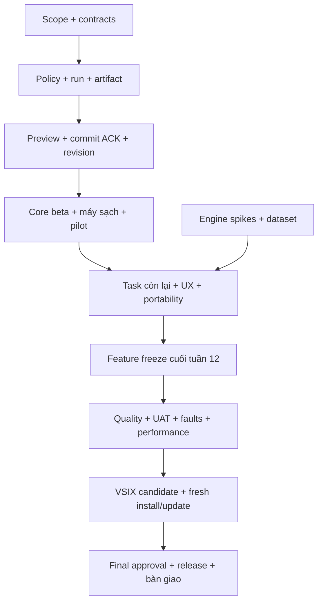

# PIXEL PILOT — KẾ HOẠCH TỔNG THỂ ĐẾN BẢN FINAL

Ngày lập: 05/11/2026. Phiên bản kế hoạch: 1.0.

### Cập nhật thực hiện — 06/11/2026

Đã có lát cắt triển khai T21 (runner và baseline local bước đầu; cần lặp lại phép đo ổn định trước tối ưu) và T22 (Setup Doctor, chưa có nghiệm thu tương tác). T23 có VSIX candidate qua build/kiểm tra cấu trúc nhưng chưa qua cài đặt, update/migration hoặc VM sạch. T24, kiểm thử chất lượng bằng bộ ảnh có quyền và đánh giá người dùng vẫn đang mở; chưa đạt mục tiêu final.

### Cập nhật thực hiện — 07/11/2026

Các lát cắt T12/T14/F04/F06 đã sửa provenance và nhãn model/basic trên Canvas, Batch và Studio; Studio bỏ executor ảnh trùng lặp. Fallback Runware sang Sharp giữ chi phí `unknown` khi không có số liệu provider, còn một số latency adapter đã được đo thực. Build, 165/165 unit/contract tests và lint pass. Đây chưa phải nghiệm thu final: run service chưa bao phủ mọi ingress, chưa có provider/UI live, holdout quality, clean Windows VM, update/migration hoặc pilot.

Rà tiếp S12/S08/S15 đã chặn false-success: mask cục bộ không bị thay bằng cutout khi lỗi; mở rộng khung bằng viền màu không bị trình bày như outpaint model; caption thiếu chữ không còn dùng placeholder. Chi phí provider đã báo vẫn được giữ trên caption fallback. Build và 170/170 test pass. S08 vẫn cần một model outpaint khả thi và đánh giá ảnh thực; không tính kết quả viền màu là hoàn thành chức năng final.

## 1. Đích cuối cùng

**Final là bản phát hành ổn định có thể cài đặt, sử dụng, nâng cấp và bàn giao**, với đầy đủ các nhóm chức năng đã chốt trong tài liệu này, kết quả kiểm chứng tái lập và quy trình bảo trì sau phát hành.

Hành trình thực hiện:

> Hệ thống hiện tại → sửa lỗi nền tảng → thống nhất thực thi → beta sáu workflow → hoàn thiện toàn bộ nhóm chức năng → kiểm chứng thực tế → release candidate → final → theo dõi và bàn giao.

Kế hoạch bao phủ sản phẩm, kỹ thuật, AI, UX, dữ liệu, kiểm thử, đóng gói, tài liệu, phát hành và hồ sơ đồ án. Đây là kế hoạch triển khai, không phải tuyên bố các hạng mục đã hoàn thành.

### Quan hệ với các tài liệu hiện có

- [Đánh giá hệ thống](DANH_GIA_VA_KE_HOACH_HOAN_THIEN.md): căn cứ phát hiện và ưu tiên kỹ thuật.
- [Kế hoạch beta chi tiết](KE_HOACH_TRIEN_KHAI_CHI_TIET.md): ticket T01–T24 cho tuần 1–8.
- **Tài liệu này là kế hoạch cấp cao nhất đến final**, bổ sung phạm vi và ticket F01–F24 cho phần sau beta. Các việc hiện có được kế thừa, không bắt đầu lại.
- [Release evidence](COPILOT_RELEASE_EVIDENCE.md): nơi ghi bằng chứng kiểm tra phát hành; cần cập nhật theo build được nghiệm thu.

## 2. Thời gian, nhân lực và cách quản lý phạm vi

### 2.1. Lịch cơ sở

**16 tuần làm việc, dự phòng thêm tối đa 2 tuần cho lỗi nghiệm thu hoặc phụ thuộc ngoài.** Tuần 1 tính từ ngày nhóm bắt đầu được xác nhận; không tự gán ngày phát hành theo lịch.

| Vai trò | Trách nhiệm |
| --- | --- |
| A — Backend/Tech lead | Kiến trúc, contracts, policy, execution, persistence, review và release blockers |
| B — Frontend/Product engineering | Canvas, chat, lịch sử, trạng thái tác vụ, onboarding, UX và accessibility |
| C — AI integration/QA engineering | Provider/model, workflow AI, quality dataset, automation, đóng gói và evidence |
| Chủ sản phẩm/nhóm trưởng | Chốt scope, rubric, tài nguyên thử nghiệm, pilot, nghiệm thu và quyết định phát hành |

Giả định A/B/C làm toàn thời gian; chủ sản phẩm tham gia ít nhất hai buổi mỗi tuần. Nguồn lực cho 16 tuần tương đương tối đa 240 ngày công của ba người. Dành khoảng 65% cho triển khai/test tại chỗ, 20% cho review/tích hợp/nghiệm thu và 15% cho sửa lỗi hoặc việc phát sinh. Đây là khung lập kế hoạch, cần đối chiếu lại tốc độ thực tế sau tuần 2.

Nếu chỉ có 1–2 người hoặc làm bán thời gian, ước lượng lại ngày kết thúc; không lấy lịch ba người làm cam kết. Chỉ các công việc độc lập mới chạy đồng thời.

### 2.2. Quy tắc thay đổi phạm vi

1. Chốt ma trận final ở cuối tuần 1: người dùng, task, engine/model, mode, acceptance, owner.
2. Từ tuần 9, yêu cầu thêm được ghi tác động tới lịch và thay thế một việc có độ lớn tương đương hoặc chuyển sau final.
3. Từ cuối tuần 12, đóng băng tính năng; chỉ sửa lỗi, cải thiện chất lượng đạt rubric và hoàn tất nghiệm thu.
4. Nếu một chức năng bắt buộc không đạt, final chưa hoàn thành. Việc loại bỏ hoặc hạ cấp chức năng cần quyết định thay đổi phạm vi rõ ràng và cập nhật toàn bộ lời hứa sản phẩm.
5. Một provider tùy chọn có thể chưa được hỗ trợ; chức năng bắt buộc vẫn phải có ít nhất một đường thực thi thật đã nghiệm thu. “Unavailable” không thay thế bằng chứng chức năng đã hoạt động.

## 3. Phạm vi chức năng của bản final

Phạm vi hệ điều hành: **Windows x64 + VS Code desktop** với ma trận phiên bản đã kiểm chứng. macOS/Linux và sản phẩm web độc lập thuộc roadmap sau final, trừ khi nhóm bổ sung nguồn lực và acceptance riêng.

| Mã | Nhóm chức năng | Cam kết final | Kiểm chứng bắt buộc |
| --- | --- | --- | --- |
| S01 | Cài đặt và chẩn đoán | Cài VSIX; chọn basic/local AI/cloud; phát hiện phụ thuộc; hướng dẫn sửa theo task | Cài trên máy sạch; thiếu từng phụ thuộc; update/uninstall theo thiết kế |
| S02 | Canvas | Mở ảnh, zoom/pan, mask, box, phím tắt/IME, compare before/after | Khung ngang/dọc, zoom, ảnh lớn, sidebar hẹp và keyboard |
| S03 | Session/DAG | Phiên lưu bền; undo/redo theo node, branch, compare, rename/delete và export/import được hỗ trợ | Reload/restart; parent sai; dữ liệu hỏng; migration; import/export refs |
| S04 | Basic asset tools | Resize/crop nếu đưa vào UI, nén PNG/WebP, alpha và metadata theo lựa chọn, icon presets, export/snippet | Đúng dimensions/aspect/format; không mất input; đường dẫn snippet đúng |
| S05 | Tách và đổi nền | Tách nền bằng model; thay nền theo prompt hoặc nền đơn sắc với mode rõ | Tóc/vật mảnh/sản phẩm; alpha; nền mới; giữ chủ thể |
| S06 | Chỉnh bằng box | FLUX.3 Klein: một ảnh tham chiếu, một box, sửa đối tượng tại vị trí hiện tại | Đúng đối tượng; vùng ngoài box; chất lượng; cost; cancel/preview |
| S07 | Inpaint | Tô mask, chỉnh/xóa theo prompt bằng model phù hợp | Không mask/empty mask; ranh giới vùng sửa; preserve region; fail giữ mask |
| S08 | Outpaint | Mở rộng ảnh theo hướng bằng model; kích thước và vùng ảnh gốc được bảo toàn theo thiết kế | Khung portrait/landscape, đường nối, nội dung sinh và aspect |
| S09 | Recolor chọn lọc | Đổi màu ít nhất tóc/trang phục hoặc các target được chốt, bằng mask/model thực | Đúng target, màu, giữ texture/da; bộ ảnh nhiều người và ánh sáng khác nhau |
| S10 | Upscale/enhance | Phân biệt model super-resolution với resize/filter; chọn mức hỗ trợ | Output dimensions, chi tiết, artifact; thiếu model không mạo nhận AI |
| S11 | Generate/style | Sinh ảnh theo prompt, lưu settings/seed nếu có; style AI và preset filter được phân biệt | Prompt adherence; thay đổi style thật; provider errors; reproducibility limits |
| S12 | Canny/lineart/depth/mask | Mỗi công cụ ghi rõ thuật toán/model; depth ngữ nghĩa phải có model | Kích thước output, cấu trúc ảnh, availability và provenance |
| S13 | Vector SVG | Tracing đường nét dùng được cho logo/icon, giữ aspect và alpha; không gắn nhãn ảnh rect đơn giản như tracing chất lượng cao | Logo/icon chuẩn, shape/path, SVG validation, độ phức tạp và khả năng chỉnh |
| S14 | OCR | Trích xuất văn bản thật, có tiếng Việt/Anh trong phạm vi đã đo; copy/export | Dấu tiếng Việt, thứ tự đọc, ảnh khó; không bịa nội dung khi không nhận được |
| S15 | Caption/analysis | Metadata đo được và mô tả ngữ nghĩa bằng model được tách rõ; alt text có giới hạn | Đúng dữ kiện; fallback metadata không khẳng định nội dung không quan sát được |
| S16 | Image-to-code | Tạo scaffold HTML hoặc React theo lựa chọn từ mockup; review trước lưu, kiểm tra overwrite | Mã parse/build được trong fixture dự án; assets/đường dẫn hợp lệ; không hứa khớp pixel tuyệt đối |
| S17 | Copilot | Tiếng Việt/Anh; tool contracts; hỏi rõ vùng thiếu; kế hoạch giới hạn; hủy và theo dõi | Cùng policy với nút; negation; ambiguous prompts; lỗi từng bước; không tool ngoài schema |
| S18 | Batch/workflow | Kế hoạch lô, progress từng ảnh, cancel, retry lỗi, output manifest và export | Partial fail, file collision, restart/recovery nếu được hỗ trợ, kiểm soát cloud |
| S19 | Quyền và chi phí | SecretStorage, trust/offline, consent theo phạm vi, actual/estimated/unknown cost | Deny/offline không upload; không log secret; không submit trùng khi outcome chưa biết |
| S20 | Độ ổn định và hỗ trợ | Run ID, timeout/cancel, lỗi có hướng khắc phục, diagnostics đã loại dữ liệu nhạy cảm, tài liệu | Fault injection, concurrency, repair/recovery, troubleshooting từ máy người dùng |

Đối với S16, hệ thống tạo mã để người dùng review; việc chạy code sinh ra trong workspace người dùng không được tự thực hiện. Fixture kiểm chứng dùng dự án thử nghiệm riêng.

Model/engine cụ thể cho các task chưa chốt phải được đánh giá trong F01/F02. Kiểm tra API, điều kiện sử dụng, cấu hình, phần cứng và chi phí tại thời điểm tích hợp; không mặc định một model duy nhất xử lý tốt mọi task.

## 4. Các giai đoạn và mốc quyết định

| Giai đoạn | Tuần | Công việc trọng tâm | Sản phẩm bàn giao | Điều kiện qua mốc |
| --- | --- | --- | --- | --- |
| G0 — Chốt sản phẩm | 1 | Scope S01–S20, risk, owner, runtime/provider matrix, sửa P0 | Scope baseline, kiến trúc và backlog được review | M0: không còn mơ hồ về final và đường nghiệm thu |
| G1 — Nền tảng chung | 2–3 | Run service, schema, policy, capability, signal, dedupe, preview transaction | Một luồng chạy chung từ UI/chat và lưu đúng DAG | M1: deny/cancel/stale/disk failure được kiểm soát |
| G2 — Core beta | 4–6 | FLUX, mask edit, history/export/batch, quality baseline, UI E2E | Sáu workflow beta; báo cáo chất lượng ban đầu | M2: core dùng được có evidence và lỗi rõ |
| G3 — Beta nghiệm thu | 7–8 | Máy sạch, setup doctor, pilot 5–10 người, sửa lỗi core | VSIX beta, pilot report, backlog sau beta đã xếp hạng | M3: beta đạt gate trong kế hoạch T01–T24 |
| G4 — Hoàn thiện tính năng | 9–12 | Toàn bộ S05–S18, provenance, artifact portability, UX cuối | Feature-complete candidate, ma trận function/provider cuối | M4: S01–S20 có triển khai; mọi task bắt buộc có đường thật |
| G5 — Xác nhận hệ thống | 13–14 | Holdout quality, pilot mở rộng, hiệu năng, fault/recovery, compatibility | Báo cáo UAT/quality/performance; release blocker list | M5: đạt tất cả tiêu chí final; không còn P0/P1 |
| G6 — Release candidate | 15 | Build/VSIX cài sạch, update/rollback, đóng gói, tài liệu và demo | Candidate bất biến theo hash + hồ sơ phát hành | M6: nghiệm thu đúng artifact sẽ phát hành |
| G7 — Final và bàn giao | 16 | Quyết định phát hành, cung cấp artifact, theo dõi, bàn giao | Stable VSIX, mã nguồn/tag khi được phép, tài liệu và hồ sơ bàn giao | M7: cài mới/nâng cấp thành công; owner tiếp nhận; không lỗi chặn |
| Dự phòng | 17–18 nếu cần | Sửa blocker, kiểm chứng lại phần ảnh hưởng | Candidate mới hoặc biên bản điều chỉnh lịch/phạm vi | Chỉ qua gate khi có evidence pass |

M4 “có đủ tính năng” khác M5 “đạt chất lượng”. Từ M4 đến final cần kiểm thử và sửa lỗi thực tế, không coi việc giao diện đã có nút là hoàn thành.

## 5. Phân công tuần 9–16

Tuần 1–8 dùng lịch và T01–T24 trong kế hoạch beta. Chuẩn bị dataset/model cho tuần 9 được khởi động từ tuần 6 khi không chặn core.

| Tuần | A — Backend | B — Frontend | C — AI/QA | Review cuối tuần |
| --- | --- | --- | --- | --- |
| 9 | Chuẩn hóa task chưa chuyển; routing; integration điểm mới | UI task picker/provider/mode; nền/recolor/upscale | Chọn engine, dataset; đổi nền/recolor/upscale thật | Toàn bộ task đã có owner, provider và acceptance |
| 10 | Artifact/export/import portability; phục hồi | UI generate/style/outpaint, OCR/caption | Workflow generate/style/outpaint; OCR/caption | Các task ảnh chính demo end-to-end |
| 11 | Image-to-code pipeline và kiểm soát lưu; batch | UI code review/OCR/vector/export presets | SVG tracing; kiểm chứng OCR/codegen; task conformance | SVG/OCR/codegen có đầu ra thật dùng được |
| 12 | Xóa nhánh executor trùng đã chuyển; metrics đầy đủ | Hoàn thiện accessibility, chat plans và i18n UI | Chốt supported matrix; regression toàn hệ thống | Feature freeze; mọi S01–S20 được truy vết |
| 13 | Fault injection, storage/concurrency; sửa blocker | Pilot UX; sửa focus/narrow layouts | Holdout quality + pilot mở rộng | Báo cáo lỗi/quality có số liệu từng task |
| 14 | Hiệu năng, recovery/migration và provider failures | Sửa UX theo evidence; tối ưu preview | Compatibility, UAT rerun, xác nhận tác động sửa lỗi | Gate final kỹ thuật/chất lượng được review |
| 15 | Chuẩn bị build candidate, update/rollback | Help/onboarding và demo cuối | VM sạch, VSIX installed E2E, kiểm tra hồ sơ | Candidate được ký nhận theo hash |
| 16 | Hỗ trợ phát hành, hotfix nếu cần, bàn giao | Hướng dẫn người dùng; sửa release blocker | Theo dõi, báo cáo tổng kết, chuyển giao suite/evidence | Stable được tiếp nhận và vận hành được |

## 6. Backlog bổ sung từ beta đến final

Ước lượng dưới đây là ngày công kỹ thuật sơ bộ; owner cập nhật sau spike. Ticket có nhiều người phải tách subtask để tránh cùng sửa một module lớn.

| ID | Đầu việc | Owner | Ước lượng | Phụ thuộc | Acceptance |
| --- | --- | --- | --- | --- | --- |
| F01 | Chốt final supported matrix, task/quality rubric và phạm vi lời hứa | A + C + chủ sản phẩm | 2 ngày | T01; chuẩn bị W6 | Mỗi S01–S20 có owner, case, provider/engine hoặc kế hoạch rõ |
| F02 | Spike engine/model còn thiếu; API conformance, phần cứng/điều kiện sử dụng | C | 4 ngày | F01 | Mỗi task bắt buộc có engine khả thi và fixture; ghi rủi ro/license/config/cost |
| F03 | Tách/đổi nền + recolor: mask/segmentation thật và giữ chủ thể | C + B | 4 ngày | T12, F02 | Task-specific dataset; mode rõ; target/skin/texture được chấm theo rubric |
| F04 | Upscale/enhance: neural và basic rõ ràng, scale validation | C + B | 2 ngày | F02, T14 | Output đúng scale; thực hiện được trên engine hỗ trợ; thiếu model báo đúng |
| F05 | Generate/style/outpaint workflow thật; cấu hình và provenance | C + B | 4 ngày | F02, T06–T11 | Preview/seed/settings nếu có; giữ source theo thiết kế; smoke thật từng task |
| F06 | Hoàn thiện preprocess Canny/lineart/depth/mask | C | 2 ngày | F02, T09 | Depth model khác filter; dimensions/provenance/capability đúng |
| F07 | SVG tracing engine và export/preview giữ aspect | C + B | 3 ngày | F02, T16 | Logo/icon giữ shape/aspect; SVG hợp lệ, có path/shape dùng được; không bóp về 48×64 |
| F08 | OCR tiếng Việt/Anh: text output, thứ tự đọc, copy/export | C + B | 3 ngày | F02, T06 | Có text thật; lỗi/không chữ rõ; báo cáo CER/WER trên ground truth |
| F09 | Caption/analysis thật và fallback metadata có giới hạn | C + B | 2 ngày | F02, T14 | Không bịa semantics từ metadata; alt text và measurements có nguồn rõ |
| F10 | Image-to-code scaffold, preview code, lưu an toàn | A + B + C | 4 ngày | T06, T16, F02 | Parse/build trong fixture; review trước ghi; bảo vệ overwrite và trust; không tự chạy mã |
| F11 | Copilot hợp nhất mọi task và bounded plan/clarification | A + B | 4 ngày | F03–F10 | Chat/nút parity; mask/box thiếu thì hỏi; lỗi step có resume/abort theo thiết kế |
| F12 | Batch mở rộng qua task hợp lệ, manifest và phục hồi | A + C | 3 ngày | T15, F03–F10 | Danh sách tool batch rõ; không ép task tương tác vào lô; retry/resume không nhân đôi |
| F13 | Asset/export presets, icon sizes, đường dẫn/snippet theo project | B + C | 2 ngày | T16, F07 | Preset dimensions/alpha đúng; paths hợp lệ; thao tác export có ACK |
| F14 | Session/artifact portability, import/export project, cache cleanup | A | 4 ngày | T17, T18 | Import trên profile mới không mất blobs/refs; validate archive/path; migration/recovery pass |
| F15 | Dọn dispatch/legacy trùng, unified error/cost/run provenance | A | 3 ngày | T12–T18, F11 | Mọi đường vào dùng service chung; không code cũ còn consumer bị xóa nhầm; parity pass |
| F16 | UX hoàn chỉnh: onboarding, keyboard, focus, narrow layout, ngôn ngữ | B | 4 ngày | T22, F03–F13 | Core keyboard-accessible; IME pass; error có bước khắc phục; layout theo ma trận |
| F17 | Dataset mở rộng, quality holdout và provider/model report | C + người chấm | 4 ngày phân bổ | F01; kết quả sau F03–F10 | Chấm riêng task/model; OCR/codegen/SVG có tiêu chí riêng; không trộn fixture/live |
| F18 | UI/integration/fault/concurrency suite toàn hệ thống | A + B + C | 4 ngày | F03–F16 | S01–S20 truy vết case; cancel/deny/stale/disk failure không sai dữ liệu/quyền |
| F19 | Performance/memory/cache profiling và tối ưu dựa phép đo | A + B + C | 3 ngày | F14, F18 | SLO ở mục 9 đạt trên máy chuẩn; số đo trước/sau và cảnh báo giới hạn |
| F20 | Compatibility + fresh install/update/rollback candidate | C + A | 3 ngày | F18, F19 | VM sạch và profile cũ pass; candidate hash đúng; update không mất session |
| F21 | Pilot mở rộng, phân tích task completion và sửa lỗi | B + C + A | 5 ngày phân bổ | M4 | 10–15 người tổng cộng, có người mới; completion và lỗi được ghi; rerun phần đã sửa |
| F22 | Final docs, báo cáo đồ án, kiến trúc, demo và claim/evidence | Cả nhóm | 4 ngày phân bổ | F17–F21 | Nội dung khớp stable scope; không dùng số placeholder như live metrics |
| F23 | Release candidate, go/no-go và phát hành khi được phép | A + C + chủ sản phẩm | 2 ngày | F20–F22 | Review đủ gate; artifact/version/hash; phát hành theo quyết định cụ thể |
| F24 | Theo dõi ban đầu, hotfix/retest, bàn giao và bảo trì | Cả nhóm | 3 ngày | F23 | Không blocker; runbook/owner/backup/release procedure được tiếp nhận |

Spike phát hiện task không khả thi phải báo trước M4, kèm lựa chọn: đổi engine, thêm thời gian hoặc thay đổi scope được ghi nhận. Không thay bằng filter/placeholder rồi đóng ticket AI.

## 7. Đường phụ thuộc quan trọng

Các blocker làm trễ final trực tiếp: thiếu đường provider thật cho task bắt buộc; preview/commit sai; mất dữ liệu migration; gửi cloud sai quyền; quality holdout không đạt; candidate không cài được trên máy sạch. Tài liệu và dataset được chuẩn bị từ sớm để tránh dồn cuối kỳ.

## 8. Kiến trúc và dữ liệu cần hoàn thiện trước final

### 8.1. Host và execution

- Tách `PixelPilotViewProvider` thành binding + application services theo task; `StudioPanel` giữ lifecycle surface.
- Tất cả UI/chat/Explorer/batch dùng typed contracts, request ID, schema, policy và run service chung.
- Capability theo task/model/runtime, không dựa duy nhất server online.
- Signal/cancel/deadline truyền xuyên adapter; cloud job unknown được đối soát bằng ID khi API hỗ trợ.
- Retry có phân loại; lỗi có thể tính phí trùng không tự submit lại khi chưa biết outcome.

### 8.2. Artifact và phiên

- Artifact ID là tham chiếu chung; UI dùng preview phù hợp, không gửi base64 ảnh lớn lặp cho mọi event.
- Preview và committed node có trạng thái tách biệt; Host quyết định commit với parent/revision.
- Lưu trước khi cập nhật selection; test lỗi disk/manifest; cleanup chỉ blob không còn ref.
- Export/import session kèm blobs hoặc manifest có cách resolve đầy đủ; không chỉ mang đường dẫn tuyệt đối của máy cũ.
- Dữ liệu cũ có schema version, backup/migration và kiểm chứng restore.
- Giữ JSON hay chuyển database dựa benchmark; không đưa migration công nghệ vào đường găng khi chưa có bằng chứng cần thiết.

### 8.3. UI và diagnostics

- Một mô hình trạng thái tác vụ; trả lời chính xác “đang chạy”, “có preview”, “đã áp dụng”, “đã xuất”.
- Giữ prompt/selection khi deny/fail; không chặn nhập IME bằng shortcut.
- Cho xem model/mode/cost/limitations ở nơi giúp người dùng quyết định.
- Chẩn đoán có request ID và cấu hình được phép chia sẻ; không log key/raw image/prompt riêng tư mặc định.

## 9. Kiểm chứng bản final

Các ngưỡng sau là **mục tiêu đề xuất**, cần chốt tại M0 và điều chỉnh có lý do trước khi nhìn kết quả holdout.

### 9.1. Chức năng và dữ liệu

- S01–S20 có case traceability, môi trường, phiên bản và evidence.
- 100% ca bắt buộc về quyền, dữ liệu, cancellation và overwrite pass: 0 upload khi deny/offline, 0 commit nhầm parent, 0 commit/auto-export sau cancel, 0 mất input do ghi đè sai.
- Task bắt buộc có ít nhất một provider/engine thật pass; mỗi đường hỗ trợ công bố có ít nhất 3 smoke runs và workflow acceptance.
- Regression + UI critical flows pass trên candidate; stub dùng để tái tạo lỗi, live dùng để chứng minh tích hợp model thật.

### 9.2. Chất lượng đầu ra

- Mở rộng bộ ảnh đến ít nhất 120 ảnh có quyền sử dụng: 80 ảnh phát triển và 40 ảnh giữ lại; tách nguồn/biến thể tránh rò rỉ giữa hai tập.
- Mỗi task AI phát hành có ít nhất 30 cặp ảnh/yêu cầu phù hợp thuộc holdout, có thể tái dùng ảnh giữa task khi hợp lý.
- Hai người chấm độc lập theo rubric 1–5; thành công khi mọi tiêu chí áp dụng từ 4/5 và không có lỗi nghiêm trọng. Mục tiêu final: ít nhất 90% case đạt cho từng task/provider/model công bố; có phân tích theo loại ảnh.
- Tách nền có ground truth thì đo mask/matting metrics; box/recolor đo giữ đối tượng và thay đổi ngoài vùng bên cạnh chấm thị giác.
- OCR đo CER/WER riêng Việt/Anh, tách ảnh in sạch và ảnh khó. Mục tiêu trên tập chữ in sạch: CER ≤5%; không dùng kết quả này khẳng định mọi ảnh đều đạt.
- SVG dùng tập logo/icon chuẩn: giữ aspect, shape, alpha; file hợp lệ, cấu trúc chỉnh sửa được và chấm thị giác theo rubric. Không chỉ xác nhận mở được SVG.
- Codegen dùng tối thiểu 20 mockup giữ lại: ít nhất 90% scaffold parse/build thành công trong fixture đã công bố; bố cục và tính dễ chỉnh sửa được đánh giá riêng. Không tự chạy mã trong project người dùng.
- Copilot: giữ golden regression; bổ sung ít nhất 100 yêu cầu người dùng chưa dùng để sửa luật, gồm Việt/Anh, phủ định, câu thiếu vùng, multi-step và provider failure. Mục tiêu chọn tool/clarify ≥95%; 100% case quyền/ngăn hành động ngoài scope bắt buộc pass.

Nếu task không đạt ngưỡng: sửa pipeline/model rồi đánh giá lại trên tập giữ lại mới hoặc tập đã khóa có ghi rõ số lần dùng. Không điều chỉnh expected theo output để tạo pass.

### 9.3. Hiệu năng và độ bền

Chốt máy chuẩn và workload ở tuần 2; đề xuất máy Windows x64 RAM 16 GB, cấu hình GPU ghi riêng cho local AI. Không gộp thời gian provider với thời gian phản hồi UI.

- p95 phản hồi nút bắt đầu/hủy ≤500 ms trên bộ workflow chuẩn.
- p95 chọn node có preview đã cache ≤1 giây trên session 100 node; ảnh gốc 4K không khiến UI phải decode toàn bộ lịch sử cùng lúc.
- Thử một phiên làm việc liên tục ít nhất 2 giờ và lô 100 ảnh basic; đo RAM/cache, handle, lỗi. Sau khi run kết thúc và cleanup, không có xu hướng tăng tài nguyên không giới hạn; định mức cụ thể chốt từ baseline.
- Lô cloud/local AI chọn kích thước phù hợp giới hạn tài nguyên và budget; không dùng 100 ảnh live mặc định chỉ để hoàn thành benchmark basic.
- Test disk full, file lock, store hỏng, provider mất kết nối, key bị xóa giữa run, timeout, reload và hủy ở các thời điểm khác nhau.
- Cache có quota cấu hình/cleanup policy; mọi kiểm tra cleanup giữ toàn bộ artifact còn được tham chiếu.

### 9.4. Compatibility và cài đặt

- Test trên Windows được công bố: VM sạch và máy có dữ liệu phiên cũ; VS Code phiên bản tối thiểu thực sự hỗ trợ và phiên bản hiện hành tại lúc nghiệm thu.
- Nếu phiên bản tối thiểu trong manifest không đạt, sửa mức hỗ trợ/implementation rồi kiểm tra lại trước release.
- Có task basic chạy không cần Python/ComfyUI; AI chỉ yêu cầu phụ thuộc của mode được chọn.
- Update qua VSIX giữ session, assets và key theo thiết kế; rollback artifact không được giả định tự đảo được schema. Cần kịch bản restore backup đã thử.

### 9.5. Pilot/UAT

- Beta: 5–10 người như kế hoạch trước.
- Trước final: tổng cộng 10–15 người dùng mục tiêu, trong đó ít nhất 5 người chưa dùng Pixel Pilot trước đó.
- Mỗi người thực hiện 3–5 nhiệm vụ có dữ liệu đầu vào và tiêu chí hoàn thành; chọn task phù hợp workflow thực tế.
- Mục tiêu: ≥90% lượt core task hoàn thành không cần người phát triển can thiệp; 0 lỗi mất dữ liệu/sai quyền; ghi thời gian, số lần retry, nguyên nhân bỏ dở.
- Thu phản hồi và review tác động; sửa các lỗi chặn rồi chạy lại task bị ảnh hưởng. Khảo sát hài lòng không thay cho bằng chứng task completion.

## 10. Hồ sơ final phải bàn giao

| Nhóm | Tài liệu/artifact |
| --- | --- |
| Sản phẩm | Scope final, persona/workflow, capability/provider matrix, known limitations |
| Kỹ thuật | Kiến trúc, protocol/tool contracts, schema/migration, run/preview lifecycle, ADR quan trọng |
| Mã nguồn | Source snapshot/commit, lockfiles, scripts build/test/package, cấu hình mẫu không có secrets |
| Bản cài | VSIX stable, version, SHA-256, hướng dẫn install/update/restore |
| Kiểm chứng | Unit/integration/UI reports, live provider records, quality holdout, performance, compatibility, UAT |
| Người dùng | Quick start, setup doctor, ví dụ prompt/task, troubleshooting, local/cloud/cost guidance |
| Đồ án/bảo vệ | Báo cáo cuối, ma trận yêu cầu→triển khai→evidence, kết quả so sánh thực nghiệm, kịch bản demo và FAQ |
| Vận hành | Runbook lỗi, cách thu diagnostics đã redacted, quota/cache recovery, issue template, release/hotfix procedure |
| Quyền sử dụng | Danh mục dependency/model/dataset, nguồn và điều kiện được phép dùng/phân phối đã ghi nhận |

Các file lớn/model/dataset có thể lưu ngoài repo theo quy định nhóm; manifest phải giúp người được bàn giao tìm và kiểm chứng đúng phiên bản. Credential thuộc tài khoản được quản lý riêng; không đưa vào gói bàn giao source.

## 11. Định nghĩa “hoàn thành final”

Chỉ đóng kế hoạch khi đáp ứng đồng thời:

1. Mọi S01–S20 đạt acceptance hoặc có quyết định thay đổi phạm vi được ghi rõ; không còn nút/tính năng bắt buộc chỉ chạy giả hoặc thiếu đường thật.
2. Không còn P0/P1 trong scope stable; P2 có mô tả, workaround nếu cần và owner xử lý.
3. Quyền, dữ liệu, preview/commit, cancellation và recovery pass trên release candidate.
4. Quality, hiệu năng, compatibility và pilot đạt mục tiêu đã chốt; evidence đúng task/provider/môi trường.
5. Candidate cài mới/update thành công; source/build/version/hash truy vết được; mọi sửa đổi sau đó tạo candidate mới và kiểm tra lại phần ảnh hưởng.
6. README, hướng dẫn, UI, báo cáo UAT và tài liệu bảo vệ phản ánh đúng khả năng đã nghiệm thu.
7. Chủ sản phẩm review hồ sơ, quyết định phát hành artifact cụ thể; có người nhận bàn giao và runbook.
8. Sau khi cung cấp final, theo dõi ít nhất 5 ngày làm việc hoặc theo cửa sổ nghiệm thu đã chốt; không còn blocker chưa xử lý. Cửa sổ này được tính vào tuần 16 khi có thể, nếu phát sinh lỗi lớn dùng dự phòng.

Phát hành công khai/Marketplace, tạo tag hoặc gửi bản cho người bên ngoài chỉ thực hiện khi người dùng/chủ sản phẩm có quyền đã cho phép hành động tương ứng. Việc chuẩn bị VSIX, hồ sơ và kiểm chứng được hoàn tất trước bước quyết định này.

## 12. Quy trình phát hành và sửa lỗi

1. Chốt scope/version; kiểm tra supported matrix và các ticket chưa đóng.
2. Build candidate từ source xác định; chạy checks, package, installed extension E2E và VM acceptance; lưu hash.
3. Review quality/UAT/security-data gates; ghi go/no-go và known issues.
4. Cung cấp/phát hành đúng artifact được phép; lưu release notes và phương án khôi phục.
5. Thu issue theo mức độ: P0 dữ liệu/quyền; P1 core task không dùng được; P2 có workaround; P3 cosmetic.
6. Hotfix luôn có regression cho lỗi, candidate mới và retest phần liên quan; không thay file nhị phân âm thầm dưới cùng version/hash.
7. Kết thúc theo dõi, bàn giao owner và lịch bảo trì. Sau final đưa tính năng mới vào phiên bản tiếp theo.

## 13. Rủi ro ảnh hưởng final

| Rủi ro | Mốc cần phát hiện | Hành động |
| --- | --- | --- |
| Không đủ người hoặc thời gian đều | W1–W2 | Đo năng lực thực, giảm WIP, ước lượng lại lịch trước cam kết |
| Thiếu provider/key/model để chứng minh task | Trước M4 | Spike sớm, chốt tài nguyên; task bắt buộc chưa có evidence sẽ chặn final |
| GPU/RAM thấp | W2 baseline, W9 task spikes | Giới hạn theo capability; mode cloud tùy chọn; không ép chạy model không phù hợp |
| Chất lượng đầu ra thấp | W6 baseline, W13 holdout | Cải thiện pipeline/model; thu hẹp claim có quyết định; dùng dự phòng nếu cần |
| API/giá/cấu hình thay đổi | Mỗi lần tích hợp và trước RC | Kiểm tra tài liệu nguồn chính thức; conformance/live smoke; cập nhật adapter và matrix |
| Migration/cleanup mất dữ liệu | W5 và W13–15 | Backup/restore, fault tests, retain refs; chặn release nếu chưa xác nhận |
| Báo cáo vượt bằng chứng | Mọi milestone, đặc biệt M6 | Trace claim→case→artifact→environment; sửa claim hoặc bổ sung nghiệm thu |
| Scope tăng liên tục | Sau W1 | Change log tác động lịch; freeze cuối W12; backlog sau final |

## 14. Bảng tiến độ cấp tổng thể

Tất cả mốc dưới đây bắt đầu ở trạng thái **chưa nghiệm thu theo kế hoạch này**. Mã có sẵn được reuse và chỉ đóng sau khi đáp ứng acceptance.

| Mốc | Tuần đích | Trạng thái | Evidence/biên bản cần có |
| --- | --- | --- | --- |
| M0 — Scope final | 1 | Chưa nghiệm thu | S01–S20 + owner + rubric + resource matrix |
| M1 — Nền tảng | 3 | Chưa nghiệm thu | Policy/run/preview/cancel/stale/disk tests |
| M2 — Core workflow | 6 | Chưa nghiệm thu | Sáu FLOW + quality baseline + UI evidence |
| M3 — Beta | 8 | Chưa nghiệm thu | VSIX beta + máy sạch + pilot report |
| M4 — Feature complete | 12 | Chưa nghiệm thu | Tất cả S có implementation và đường thật; feature freeze |
| M5 — Final validation | 14 | Chưa nghiệm thu | Quality/UAT/performance/compatibility; P0/P1=0 |
| M6 — Release candidate | 15 | Chưa nghiệm thu | Candidate hash + install/update/restore + release dossier |
| M7 — Final/bàn giao | 16, tối đa 18 nếu dùng dự phòng | Chưa nghiệm thu | Quyết định phát hành, stable artifact, owner/runbook và kết quả theo dõi |

Buổi khởi động chốt tên thật A/B/C, D1, tài nguyên provider và người quyết định nghiệm thu. Bắt đầu bằng T01–T05, chuẩn bị F01/F02 sớm, sau đó đi theo các mốc M0–M7 đến khi đáp ứng định nghĩa final.
