# KẾ HOẠCH TRIỂN KHAI HOÀN THIỆN PIXEL PILOT

Phiên bản kế hoạch: 1.0 — lập ngày 05/11/2026.

Phạm vi tài liệu: giai đoạn beta tuần 1–8 trong [kế hoạch tổng thể đến final](KE_HOACH_TONG_THE_DEN_FINAL.md). Phạm vi final, giai đoạn tuần 9–16 và điều kiện bàn giao được quản lý tại kế hoạch tổng thể.

Cơ sở: [Đánh giá hệ thống hiện tại](DANH_GIA_VA_KE_HOACH_HOAN_THIEN.md). Kế hoạch này cụ thể hóa việc cần làm; các ticket dưới đây chưa được coi là đã hoàn thành. Baseline kiểm chứng gần nhất: build/type-check/lint pass, 115/115 regression tests pass; chưa có nghiệm thu đầy đủ UI, cloud live và máy cài sạch.

## 1. Mục tiêu và sản phẩm bàn giao

Trong 8 tuần làm việc, đưa Pixel Pilot đến bản beta Windows x64 dành cho lập trình viên xử lý tài nguyên ảnh trong VS Code.

Người dùng phải hoàn thành được quy trình:

> Cài extension → kiểm tra môi trường → mở ảnh dự án → chọn local/cloud → chỉnh ảnh → so sánh → áp dụng hoặc hủy → khôi phục/thử nhánh khác → xuất ảnh và chèn đường dẫn vào code.

Sản phẩm bàn giao:

1. VSIX beta có version, commit nguồn và SHA-256 xác định.
2. Sáu luồng sử dụng đạt nghiệm thu tại mục 3.
3. Bộ kiểm thử UI và regression chạy được trong CI/phòng kiểm thử.
4. Báo cáo chất lượng đầu ra, độ ổn định, hiệu năng và chi phí theo đúng phạm vi đo.
5. Hướng dẫn cài đặt, chẩn đoán thiếu phụ thuộc, demo và danh sách giới hạn.
6. Hồ sơ pilot 5–10 người dùng và danh sách lỗi đã xử lý/còn mở.

## 2. Giả định nguồn lực và cách lập lịch

Lịch dùng **D1–D40**, mỗi tuần 5 ngày làm việc, tính từ ngày nhóm bắt đầu. Chưa ấn định ngày phát hành theo lịch vì chưa có ngày bắt đầu và nguồn lực được xác nhận.

| Vai trò | Trách nhiệm chính | Mức tham gia giả định |
| --- | --- | --- |
| A — Backend/Tech lead | Host, protocol, policy, run service, session/artifact, review kiến trúc | Toàn thời gian |
| B — Frontend | React, Canvas, chat, trạng thái tác vụ, compare, onboarding UI | Toàn thời gian |
| C — Integration/QA | Adapter/model, fixture, UI automation, benchmark, đóng gói và nghiệm thu | Toàn thời gian |
| Chủ sản phẩm | Chốt phạm vi, chất lượng chấp nhận được, chọn người pilot và quyết định phát hành | 2 buổi/tuần |

Một người có thể kiêm nhiều vai trò, nhưng cần giảm lượng việc hoặc kéo dài lịch tương ứng. Ước lượng ticket ở mục 6 là **ngày công thực hiện**, đã có kiểm tra tại chỗ; review, tích hợp và sửa lỗi liên thành phần dùng các ngày đệm trong lịch. Không cộng các ticket thành thời lượng lịch vì có phần chạy đồng thời.

Nguyên tắc điều hành:

- Mỗi người giữ tối đa một ticket triển khai chính tại một thời điểm.
- Thứ Hai chốt đầu ra tuần; thứ Sáu demo bằng workflow và lưu evidence.
- Lỗi mất dữ liệu, gửi cloud khi bị từ chối/offline, ghi đè sai hoặc commit sai ảnh dừng việc phát triển tính năng để xử lý.
- Kết thúc mỗi tuần cập nhật trạng thái ticket, log kiểm tra, artifact và việc chuyển tuần; không đánh dấu xong chỉ vì mã đã merge.
- Tuần 7–8 ưu tiên sửa lỗi và nghiệm thu. Tính năng mới đi vào backlog sau beta.

## 3. Chốt phạm vi beta

### 3.1. Sáu luồng bắt buộc

| Mã | Luồng | Điều kiện đạt |
| --- | --- | --- |
| FLOW-01 | Mở ảnh → resize/nén → xuất asset → chèn snippet | Đúng kích thước/format/alpha theo lựa chọn; không ghi đè input ngoài ý muốn; snippet trỏ tới file đã xuất |
| FLOW-02 | Tách nền → so sánh → áp dụng → undo | Hiển thị đúng model/basic; PNG alpha hợp lệ; undo không gọi provider |
| FLOW-03 | Tô mask → nhập yêu cầu → inpaint → giữ/hủy | Vùng chọn đúng tọa độ; fail/deny giữ mask; chỉ tạo node sau apply được Host xác nhận |
| FLOW-04 | Khoanh box → FLUX.3 Klein → so sánh → áp dụng | Một reference, một đối tượng tại vị trí hiện tại; có metrics/provenance; ảnh đạt tiêu chí chất lượng ở mục 9 |
| FLOW-05 | Hội thoại yêu cầu tác vụ/chuỗi có giới hạn → đổi phiên/rollback/branch | Dùng cùng policy và executor với nút; không commit nhầm session hoặc tự đổi selection sau kết quả muộn |
| FLOW-06 | Chọn thư mục → chọn tác vụ/output → batch → hủy/chạy lại mục lỗi | Có trạng thái từng file; kết quả thành công được giữ; không gửi lại mục đã xong khi retry lỗi |

Trong FLOW-05, tác vụ trực tiếp dùng lại các tool trong phạm vi beta. Chuỗi tự động ban đầu chỉ gồm các tool đã có contract tuần tự ổn định; bước cần người dùng vẽ mask/box sẽ dừng để yêu cầu chọn vùng, không tự suy đoán vùng.

### 3.2. Phạm vi hỗ trợ và tính năng tùy chọn

- Sharp: resize, nén, thao tác ảnh cơ bản và metadata.
- ComfyUI: chỉ quảng bá task khi node/model/runtime cho task đó đã được kiểm chứng.
- Runware: FLUX.3 Klein box edit và tách nền nếu đạt nghiệm thu riêng.
- InvokeAI/sinh ảnh: giữ tích hợp hiện có; chỉ đưa vào danh sách hỗ trợ beta sau khi có smoke và workflow test tương ứng.
- Recolor, outpaint, style, SVG hiện tại: ghi rõ engine/mode và giới hạn; tính năng chưa đạt chất lượng đặt trong mục thử nghiệm.
- OCR, image-to-code nâng cao, vector tracing mới, nhiều box/nhiều reference và thêm model mới: đưa vào giai đoạn sau beta.
- Giao diện web hiện có dùng cho phát triển/demo; phạm vi phát hành đợt này là extension VS Code Windows x64.

### 3.3. Nguyên tắc kết quả

Lệnh “dùng model AI” phải tạo kết quả từ model phù hợp hoặc báo không khả dụng/thất bại. Nếu có lựa chọn xử lý cơ bản thay thế, người dùng được biết và chọn rõ. Mọi kết quả ghi provider, model khi biết và mode thực tế.

## 4. Thiết kế triển khai cần thống nhất trong tuần 1

### 4.1. Một đường thực thi dùng chung

```mermaid
flowchart LR
    Entry[Canvas / Chat / Explorer / Batch] --> Request[RunRequest]
    Request --> Policy[Policy + validation]
    Policy --> Route[Capability + provider selection]
    Route --> Run[Run service + adapter]
    Run --> Output[Validated artifact + metrics]
    Output --> Preview[Preview]
    Preview --> Apply[Apply / Discard]
    Apply --> Commit[Commit DAG]
    Commit --> Export[Export / snippet]
```

Thực hiện chuyển dần theo tác vụ. Sau khi một task được chuyển, các đường vào của task đó gọi cùng service. Giữ bộ regression hiện có; gỡ nhánh cũ sau khi tìm consumer, chuyển xong và kiểm tra parity.

### 4.2. Hợp đồng tối thiểu

| Hợp đồng | Dữ liệu bắt buộc | Quy tắc |
| --- | --- | --- |
| RunRequest | requestId, sessionId, parentNodeId, expectedRevision, tool, args, provider preference | Validate tại Host; ID trùng cùng nội dung trả trạng thái đã có; ID trùng khác nội dung trả conflict |
| RunState | queued/running/awaiting_apply/succeeded/failed/cancelled/timed_out | Phân biệt kết quả sẵn sàng và đã commit; một trạng thái cuối cho mỗi run |
| ToolResult | artifactId, provider, mode, modelId nếu biết, duration, cost, warnings | Chi phí có trạng thái actual/estimated/unknown; unknown không hiển thị như miễn phí |
| PreviewRecord | previewId, runId, parentNodeId, revision, artifactId, trạng thái | Apply một lần; discard không tạo node; có TTL/quy tắc dọn cache |
| HostEvent | requestId, event sequence, sessionId, trạng thái/ACK hoặc lỗi | UI bỏ event lỗi thời; không suy ra thành công từ việc đã gửi message |

Cloud phải được kiểm tra quyền và offline ngay trước khi gửi. Batch xin chấp thuận theo phạm vi lô đã chọn; thêm ảnh/tác vụ/provider ngoài phạm vi cần cập nhật xác nhận. Kiểm tra lại trước từng request để xử lý thay đổi offline hoặc hủy.

### 4.3. Quyết định về commit và export

- Preview lưu vào cache do extension quản lý; không tự xuất vào thư mục dự án.
- Apply được Host xác nhận mới tạo node và đổi trạng thái hiển thị.
- Nếu parent/revision đã đổi, kết quả vẫn thuộc parent gốc. Cho người dùng chọn tạo nhánh từ parent gốc hoặc bỏ; không âm thầm áp vào ảnh khác.
- Export là bước riêng sau apply; batch có thể chạy chế độ auto-apply/export sau khi người dùng chấp thuận kế hoạch lô.
- Export dùng tên mới mặc định; ghi đè cần lựa chọn rõ và có cách phục hồi theo thiết kế được chốt.
- Hủy chặn commit/auto-export muộn. Việc provider đã nhận job có thể vẫn phát sinh phí; UI phản ánh trạng thái biết được.
- Khi không biết cloud đã nhận job hay chưa, ưu tiên đối chiếu job/task ID nếu API cho phép; không tự gửi lại request có thể tính phí lần hai.

## 5. Lịch triển khai theo tuần

| Tuần | A — Backend | B — Frontend | C — Integration/QA | Mốc thứ Sáu |
| --- | --- | --- | --- | --- |
| 1 | Chốt contracts; chặn batch bypass; thiết kế run/preview | Sửa shortcut/IME/mask/box; trạng thái chờ xử lý | Lập capability matrix, fixture và reproducer P0 | M1: baseline và P0 được kiểm soát |
| 2 | Run service, dedupe, signal, error taxonomy | State theo requestId; cancel; lỗi có hướng khắc phục | Adapter signal/timeout; capability probes | M2: một task chạy qua service chung từ nút/chat |
| 3 | Preview service và commit ACK/revision | Compare/apply/discard; giữ lựa chọn khi fail | Chuyển tách nền/mask edit và đo provenance | M3: preview transaction chạy từ đầu đến cuối |
| 4 | Hoàn thiện routing, chuyển FLUX; batch plan/manifest | Box interaction, provider/mode/cost; export UI | FLUX live acceptance; export/snippet; batch lỗi | M4: FLUX dùng được có kiểm chứng |
| 5 | Artifact refs/recovery; parity các đường vào | History compare/branch/rollback; onboarding | Bộ UI E2E chính; batch resume/retry | M5: sáu workflow hoạt động xuyên suốt |
| 6 | Tối ưu theo phép đo; sửa lỗi concurrency/storage | Tối ưu ảnh preview, focus/sidebar hẹp | Quality holdout, benchmark, báo cáo provider | M6: số liệu chất lượng và hiệu năng có thể review |
| 7 | Sửa release blockers; ổn định candidate | Setup doctor và lỗi phát hiện từ pilot sớm | VM sạch, VSIX smoke, pilot đợt 1 | M7: release candidate có đủ evidence cài đặt |
| 8 | Sửa lỗi pilot, chốt migration/recovery | Sửa UX pilot, hoàn tất hướng dẫn | Pilot còn lại, regression, release hồ sơ cuối | M8: quyết định phát hành beta hoặc danh sách chặn |

Nếu một mốc không đạt, giữ các bước phụ thuộc ở trạng thái chờ; dùng ngày đệm hoặc giảm tính năng tùy chọn. Không bỏ kiểm tra quyền, dữ liệu và phục hồi để giữ lịch.

## 6. Ticket triển khai và tiêu chí nghiệm thu

Các tên file “đề xuất” chưa phải module đã tồn tại. Người thực hiện có thể điều chỉnh vị trí khi review kiến trúc, nhưng phải giữ trách nhiệm và acceptance.

| ID | Đầu việc và phạm vi mã | Chủ trì | Ước lượng | Phụ thuộc | Tiêu chí nghiệm thu |
| --- | --- | --- | --- | --- | --- |
| T01 | Lập `docs/BETA_CAPABILITY_MATRIX.md`: tool, mode, provider, runtime, status, evidence | C + A | 1 ngày | — | Mỗi nút/tool trong beta có trạng thái supported/experimental/unavailable và lý do |
| T02 | Sửa batch policy trong `extension.ts`, `BatchProcessor.ts`; chuyển sang policy dùng chung | A | 2 ngày | — | Offline/deny không upload; hủy dừng mục kế tiếp; output không ghi đè input ngoài lựa chọn |
| T03 | Sửa shortcut/IME/bubbling trong `Canvas.tsx` | B | 1 ngày | — | Gõ tiếng Việt và B/E/0/+/- trong input bình thường; một phím canvas chỉ xử lý một lần |
| T04 | Giữ mask/box/prompt; Pointer Events/capture; reset theo image identity | B | 2 ngày | T03 | Kéo các hướng/zoom đúng tọa độ; fail/deny giữ input; chuyển ảnh không dùng nhầm selection |
| T05 | Chốt contracts trong `shared/protocol.ts`, `shared/tool-contracts.ts` và ADR preview/run | A + B | 2 ngày | T01 | Request/event/result/preview có schema và bảng chuyển trạng thái; không còn field mơ hồ về commit |
| T06 | Run service chung, đề xuất `services/execution/ApplicationRunService.ts` | A | 4 ngày | T05 | Request dedupe/conflict; pin session/parent; một terminal state; chống commit sau cancel |
| T07 | Sửa signal/timeout trong fetch helper và adapter; chính sách retry có tính phí | C | 3 ngày | T05 | Hủy truyền tới transport hỗ trợ; timeout riêng cancel; không resubmit khi trạng thái cloud chưa rõ |
| T08 | State UI theo request, đề xuất `hooks/useImageRun.ts`; nút busy/cancel/retry | B | 3 ngày | T05, T06 | Event cũ không đổi ảnh; double click không tạo job kép; mọi fail/deny kết thúc busy |
| T09 | Capability probe/routing theo task/model trong `ProviderCatalog.ts` | C | 3 ngày | T01, T05 | Health server không đồng nghĩa mọi tool sẵn sàng; thiếu node/model hiện đúng lý do |
| T10 | Preview service, đề xuất `services/session/PreviewService.ts`; apply/discard handlers | A | 4 ngày | T06 | Apply idempotent; stale revision có quyết định rõ; disk fail không báo applied; discard không tạo edit node |
| T11 | Nối `CompareView`/`App` tới Host ACK; so sánh lịch sử | B | 3 ngày | T08, T10 | So sánh không gọi provider; UI chỉ báo applied sau ACK; bỏ preview trả về ảnh đang chọn |
| T12 | Chuyển task tách nền/inpaint/basic edit từ UI/chat/Explorer sang run service | A + C | 4 ngày | T06, T07, T09, T10 | Parity policy/provider/mode/provenance; nhánh fallback thông báo rõ; giữ regression pass |
| T13 | Hoàn thiện FLUX box contract, adapter, run/preview và UI | B + C | 4 ngày | T04, T07–11 | Một box → một job → preview → một commit; lỗi key/credits/timeout/reload được xử lý; giữ prompt khi fail |
| T14 | Metrics/provenance thực; sửa nhãn fallback/caption/SVG | C | 2 ngày | T12, T13 | Duration đo được; cost actual/estimated/unknown; caption basic chỉ mô tả metadata; SVG/basic labels đúng engine |
| T15 | Batch manifest, progress/cancel, retry mục lỗi và output collision | C + A | 3 ngày | T02, T06, T12 | Thử lô 10 ảnh có lỗi xen kẽ; giữ mục thành công; retry không xử lý lại mục đã xong |
| T16 | Export preset PNG/WebP, resize, snippet và đường dẫn | B + C | 3 ngày | T10, T12 | Đúng dimensions/aspect/alpha theo preset; lỗi export không mất node; snippet chỉ chèn sau export thành công |
| T17 | Hợp nhất artifact refs dần, recovery và pruning; kiểm tra manifest ghi đồng thời | A | 4 ngày | T10, T14 | Node trỏ tới artifact tồn tại; cache lỗi có phục hồi; pruning giữ mọi ref hợp lệ; migration có backup |
| T18 | Lưu session/branch/rollback và parity kiểm chứng trên sáu luồng | A + B | 2 ngày | T11–17 | Reload giữ DAG/ảnh; job muộn thuộc đúng nhánh; rollback không gọi lại API |
| T19 | Bộ ảnh, rubric, holdout và chấm chất lượng từng task | C + chủ sản phẩm | 4 ngày phân bổ | T01; kết quả sau T12–14 | Dataset có quyền sử dụng/hash; 2 người chấm; báo riêng từng task, mode và provider |
| T20 | UI E2E: nhập liệu, mask/box, preview, cancel, đổi phiên, lỗi, export | B + C | 4 ngày | T08, T11–18 | Các case mục 9 chạy tái lập; screenshot/log gắn version và test ID |
| T21 | Benchmark ảnh 4K, phiên 100 node; sửa điểm nghẽn đã đo | A + C | 3 ngày | T17, T18 | Có baseline/p50/p95/RAM/disk; mỗi tối ưu kèm số đo trước/sau và không giảm chất lượng |
| T22 | Setup doctor và hướng dẫn sửa môi trường | B + C | 3 ngày | T09 | Phân biệt thiếu key/server/node/model/Python/ONNX; không yêu cầu cấu hình phần không dùng |
| T23 | VSIX candidate, CI gates, Windows VM sạch và update/migration | C + A | 3 ngày | T20–22 | Cài/activate/workflow cơ bản trên VM sạch; update giữ session; hash/commit xác định |
| T24 | Pilot, sửa lỗi, UAT/evidence/release notes và quyết định beta | Cả nhóm | 5 ngày | T19, T23 | 5–10 người tham gia; lỗi P0/P1 trong scope đã đóng; hồ sơ phát hành đầy đủ |

Việc sửa lỗi phát hiện trong nghiệm thu có thể làm tăng ước lượng. Nếu nhóm chỉ có một người, dùng thứ tự phụ thuộc này làm backlog tuần tự và ước lượng lại lịch.

## 7. Năm ngày đầu tiên cần làm gì

| Ngày | Việc cụ thể | Sản phẩm review cuối ngày |
| --- | --- | --- |
| D1 | A chốt acceptance beta và rà mọi đường vào cloud; B ghi reproducer shortcut/mask/box; C lập ma trận provider/tool | Danh sách scope, ma trận ban đầu, 3 ticket P0 có bước tái hiện |
| D2 | A sửa batch policy; B sửa shortcut/IME; C bổ sung regression cho các lỗi này | Thay đổi T02/T03 có kiểm tra, video/log tái hiện trước/sau |
| D3 | A soạn contracts/run state; B hoàn thiện giữ selection/pointer; C kiểm tra offline/deny/reconnect | T04 chạy được; draft T05; bằng chứng deny không gọi cloud |
| D4 | A+B review apply/discard/revision; C dựng fixture transport có timeout/lỗi/key hết hiệu lực | ADR được thống nhất; API contract đủ để FE/BE làm độc lập |
| D5 | Chạy checks, demo mở ảnh và lỗi, gắn nhãn tính năng chưa nghiệm thu; chia ticket tuần 2 | M1: báo cáo pass/fail, PR đã review, backlog tuần 2 và blocker rõ |

Kết thúc D5 chưa bắt buộc có preview hoàn chỉnh; phải có hợp đồng và loại bỏ thông báo “đã áp dụng” khi Host chưa xác nhận trong đường UI đang hoạt động.

## 8. Hoàn thiện FLUX.3 Klein cụ thể

### 8.1. Giao diện

1. Mở ảnh, chọn công cụ “Chỉnh đối tượng bằng FLUX”.
2. Kéo box; có xóa/vẽ lại và hiển thị vùng chọn rõ ở mọi mức zoom.
3. Nhập “Đối tượng đang có” và “Thay đổi mong muốn”; ví dụ: “chiếc áo đỏ” / “đổi áo thành xanh navy, giữ chất liệu”.
4. Hiển thị Runware, trạng thái kết nối và thông tin chi phí nếu có; không đưa ra giá cố định khi chưa có căn cứ.
5. Xác nhận gửi ảnh theo policy, chạy và cho hủy.
6. Hiển thị ảnh gốc/kết quả, model, thời gian, chi phí actual/unknown và ghi chú về khả năng thay đổi ngoài box.
7. Chọn áp dụng hoặc bỏ; chỉ báo thành công sau ACK Host.

### 8.2. Backend

- Schema `image.edit_region` đề xuất: artifact đầu vào, box chuẩn hóa `[top,left,bottom,right]`, description, instruction; phiên beta chỉ hỗ trợ một box.
- Chuyển tọa độ từ ảnh hiển thị sang hệ chuẩn hóa đúng một lần; kiểm tra cạnh, thứ tự, box rỗng và image revision tại Host.
- Adapter giữ mapping API Runware đã kiểm chứng; thêm signal, task ID, output validation và thông tin chi phí.
- Dùng preview/artifact service chung; không để adapter trực tiếp cập nhật DAG.
- Lưu input hash, box, prompt, provider/model và run ID; không ghi secret hoặc raw image vào log chẩn đoán.
- Không ghép lại vùng ngoài box một cách mặc định trước khi đánh giá seam/ánh sáng; dùng preview và rubric để người dùng kiểm tra.

### 8.3. Kiểm chứng

Case tối thiểu: đổi màu một đồ vật, đổi chất liệu, đổi trang phục; nhiều đối tượng cạnh nhau; box ở sát mép; khung ngang/dọc; ảnh 4K; kéo ngược; zoom 25/100/200%; hủy/timeout; thiếu credits/key; session đổi giữa lúc chờ; double click; discard và apply lặp.

Cloud live chỉ chạy với credential được phép dùng và giới hạn thử nghiệm đã chốt. Nếu chưa có điều kiện chạy live, FLUX giữ nhãn experimental và không được tính là đã đạt M4.

## 9. Kiểm thử, đo lường và điều kiện nghiệm thu

### 9.1. Nhóm kiểm thử bắt buộc

| Nhóm | Ca kiểm tra | Kỳ vọng |
| --- | --- | --- |
| Policy | Offline, restricted workspace, deny, đổi offline giữa batch | Không có cloud upload ngoài quyền đã cấp |
| Concurrency | Double click, replay ID, ID khác nội dung, đổi node/session | Một tác vụ hợp lệ; conflict rõ; không commit nhầm parent |
| Cancel/timeout | Hủy trước gửi, trong khi chạy, khi lưu output; provider trả muộn | Không commit/auto-export muộn; kết thúc busy; phân biệt trạng thái chưa biết ở cloud |
| Preview | Apply/discard lặp, preview hết hạn, parent đổi, disk đầy | Không tạo node kép; không success giả; giữ kết quả trước đó |
| Canvas | IME, input, keyboard, mask/box, zoom, pointer rời vùng | Nhập bình thường; tọa độ đúng; giữ selection khi fail |
| Persistence | Reload, extension restart, update, store hỏng, pruning | Giữ dữ liệu hợp lệ; phục hồi có thông báo; không xóa artifact đang được tham chiếu |
| Export/batch | File collision, partial fail, hủy lô, retry | Không mất input/kết quả tốt; retry chỉ các mục được chọn |
| Setup/package | Thiếu model/key, VM sạch, VSIX install/update | Chỉ dẫn đúng phụ thuộc; core basic flow dùng được sau cài đặt |

### 9.2. Chất lượng ảnh

- Chuẩn bị 60 ảnh hợp lệ về quyền sử dụng; chia 40 ảnh điều chỉnh và 20 ảnh giữ lại cho nghiệm thu. Lưu hash và nhóm nội dung.
- Với mỗi task AI sẽ phát hành, tạo tối thiểu 20 cặp ảnh/yêu cầu phù hợp thuộc tập giữ lại. Nếu một loại ảnh không phù hợp task, bổ sung ảnh giữ lại tương ứng thay vì ép dùng.
- Hai người chấm độc lập thang 1–5 cho: đúng yêu cầu, giữ đối tượng/chi tiết cần bảo toàn, vùng ngoài chọn, độ tự nhiên. Ghi N/A khi tiêu chí không áp dụng.
- Một case đạt khi các tiêu chí áp dụng đều từ 4/5 và không có lỗi nghiêm trọng; bất đồng được review và lưu lý do.
- Mục tiêu đề xuất: tối thiểu 17/20 case đạt **cho từng task/provider/model được phát hành**; không gộp kết quả để che tool yếu. Chủ sản phẩm chốt rubric trước khi chạy holdout.
- Basic resize/compress phải đúng định dạng/kích thước/alpha theo thiết kế trong toàn bộ fixture bắt buộc. Chất lượng nén được kiểm tra thị giác trên bộ ảnh chuẩn.

### 9.3. Hiệu năng và chi phí

- Ghi cấu hình máy, kích thước ảnh, provider/model/settings và số lần chạy cho mọi báo cáo.
- Mục tiêu UI: phản hồi trạng thái bắt đầu/hủy trong 500 ms trong bộ kịch bản trên máy nghiệm thu; đo p50/p95, không tính thời gian provider vào độ trễ phản hồi nút.
- Đo ảnh 4K và session 100 node: thời gian mở/chọn node, RAM, dung lượng cache và độ trễ ghi session. Dùng baseline tuần 2 và mục tiêu được chốt trước tối ưu tuần 6.
- Adapter báo latency đo được và cost actual/estimated/unknown. Thiếu cost không hiển thị 0 USD như số thực.
- Chốt hạn mức thử nghiệm theo số request/ảnh và mức chi được người sở hữu tài khoản đồng ý. Dừng gửi thêm khi chạm hạn mức biết được; ghi rõ phần chi phí đang chờ đối soát.

### 9.4. Evidence phải lưu

Đề xuất thư mục `evidence/beta/<build-id>/` gồm manifest môi trường, test summary, ảnh/screenshot cần thiết, log đã loại dữ liệu nhạy cảm, output hash và báo cáo lỗi. Bộ ảnh lớn/model/credential không đưa vào repository; manifest trỏ tới nơi lưu được nhóm cho phép.

Không thay thế UI acceptance bằng planner fixture; không thay thế quality evaluation bằng việc ảnh đầu ra đổi pixel hoặc API trả success.

## 10. Điều kiện đóng ticket và phát hành

### Definition of Done cho ticket

- Có mô tả trigger, hành vi mong muốn và phạm vi mã thay đổi.
- Code được review; kiểm tra phù hợp với rủi ro đã pass.
- Không phát sinh regression ở các đường vào liên quan.
- Có evidence cho acceptance; tài liệu/capability matrix được cập nhật nếu hành vi thay đổi.
- Khi thiếu provider/key/thiết bị, ghi blocked cho phần nghiệm thu đó; không tự đánh dấu pass.

### Release gate beta

1. Sáu FLOW đạt nghiệm thu; tính năng chưa đạt được loại khỏi phạm vi mặc định hoặc gắn experimental rõ ràng.
2. Không còn lỗi mất dữ liệu, sai quyền, sai ảnh/parent, tính phí trùng do gửi lặp, hoặc P0/P1 khác trong phạm vi phát hành.
3. CI và UI critical flows pass; VSIX install/update trên Windows VM sạch pass.
4. Công cụ AI công bố hỗ trợ đạt rubric đã chốt; mỗi provider/model có ít nhất 3 smoke runs có evidence.
5. Cài đặt, troubleshooting, giới hạn model/mode/cost, UAT và release notes khớp kết quả thực.
6. Pilot tối thiểu 5 người hoàn thành các workflow phù hợp; ghi rõ tỷ lệ hoàn thành không cần trợ giúp và các lý do cần hỗ trợ. Nếu dưới 80% người dùng hoàn thành core task không cần trợ giúp, sửa onboarding/workflow và chạy lại phần bị lỗi trước phát hành.
7. Chủ sản phẩm review hồ sơ và quyết định phát hành bản candidate cụ thể. Quyết định dựa trên build/hash đã nghiệm thu.

## 11. Rủi ro và cách xử lý

| Rủi ro | Dấu hiệu | Xử lý cụ thể |
| --- | --- | --- |
| Thiếu credits/quyền cloud | Không chạy được T13/T19 live | Làm contract/error tests trước; giữ experimental; dành slot nghiệm thu live trước khi chốt scope |
| GPU 4 GB không đủ | OOM/timeout ở ảnh lớn | Probe/runtime guidance, giới hạn kích thước theo capability; cho người dùng chọn cloud hoặc giảm kích thước rõ ràng |
| Refactor ảnh hưởng nhiều đường cũ | Nút và chat cho kết quả khác | Chuyển từng task, kiểm tra parity; chỉ gỡ legacy khi hết consumer |
| Provider thay API/schema | HTTP validation error hoặc output khác | Fixture conformance và smoke theo version; cô lập mapping trong adapter |
| Chất lượng box edit không ổn định | Đổi sai vật thể/vùng ngoài box | Giữ preview, chấm holdout; thu hẹp scope task; không tự áp kết quả |
| Lịch trễ | Mốc tuần không đạt | Giữ các gate dữ liệu/quyền; chuyển OCR/image-to-code/model bổ sung sang sau beta; ước lượng lại mốc phụ thuộc |
| Báo cáo khác evidence | Claim không có case/artifact tương ứng | Review ma trận claim/evidence ở M6 và M8; sửa báo cáo trước release |

## 12. Bảng theo dõi hàng tuần

Mẫu điền vào cuối mỗi tuần:

| Tuần/build | Ticket đã nghiệm thu | Ticket đang làm/blocker | Checks/evidence | Lỗi P0/P1 | Việc tuần sau | Người xác nhận |
| --- | --- | --- | --- | --- | --- | --- |
| W1 / current working tree | T01-T04; T05 protocol slice; T06 dedupe; T07 FLUX cancel propagation; T08 FLUX cancel UI; T10-T11 FLUX preview; T14 Runware provenance partial; T15 batch fixture; T16 export implementation partial; T17 artifact recovery/prune partial; T18 FLOW-05 host integration; T19 quality-eval validator scaffold; T20 isolated Extension Host shell smoke (partial); T21 initial local baseline; T22 Setup Doctor implementation plus probe fixtures; T23 VSIX structural candidate | Existing `npm run check` PASS 145/145 is from the prior revision; current T22 probe fixture 5/5, ProviderCatalog 5/5, lint/type-check PASS; T21 baseline and T23 VSIX hash linked in release evidence; Extension Host doctor smoke blocked before assertions by VS Code download `EACCES` | T21 needs stable repeat measurements and quality comparison; UI critical flows, live provider cost/quality, standard Electron-sandbox E2E, clean VM, pilot, VSIX install/update and interactive doctor acceptance unaccepted | Repeat T21 with controlled profile; finish T22 runtime acceptance when a VS Code test host is available; complete T23 install/VM/update and T24 pilot by dependencies | Unassigned |

Ba quyết định nhóm cần chốt ở buổi D1: gán tên thật cho A/B/C, chọn ngày bắt đầu D1 và xác nhận provider/model cùng tài nguyên dùng để nghiệm thu. Các đầu việc kỹ thuật đã có thể đưa vào bảng quản lý theo ID T01–T24.

### Progress update ? T14 provenance and labels ? 05/11/2026

- `npm.cmd run check`: PASS 129/129; `npm.cmd run lint`: PASS.
- Copilot operation latency is measured; cost provenance distinguishes actual/estimated/unknown; Runware requests provider-reported cost. Basic caption and SVG tracer labels now reflect actual behavior.
- VSIX candidate package, structural verification, isolated installation, Sharp runtime, and missing-model behavior smoke PASS. SHA-256: `738A79574FECF06BA89073479717CB4407F7BB4A5B7216E9A68BCFA36BB9B641`.
- T14 is only partially complete: other adapters/canvas paths and live cost need acceptance. Next, complete remaining T12-T14 rollout and T16 export acceptance by dependencies. UI, clean VM, live provider, E2E, and pilot gates remain open.

### Progress update ? T16 export implementation slice ? 05/11/2026

- Full check PASS 132/132; lint PASS. Export encoder tests verify custom fit dimensions, aspect ratio, PNG/WebP alpha, no enlargement, and invalid bounds.
- UI host offers PNG/WebP, original/1024/2048/custom bounds; writes through a temporary file and asks about snippet insertion after save succeeds.
- VSIX candidate structural and isolated-install smoke PASS. SHA-256: `BF5AFA068D787877A460793D6AC80B353811A78330851D88E0113024E1AD7A9C`.
- T16 remains partial until interactive acceptance covers save dialog cancellation, overwrite, error, and snippet paths. Other release gates remain open.

### T14 follow-up ? Canvas duration ? 05/11/2026

- Canvas actions now pass measured processing duration to session metrics; FLUX retains provider request timing. Full check 133/133 and lint pass. Rebuilt isolated-smoke candidate SHA-256: `F2DBEA086647AD0033CB5B0F784AE0770E4AEC088597EA720A78B2355D8F5123`.
- T14 remains open for direct adapter ingress outside these flows and provider/UI acceptance.

### T14 follow-up ? priority tools and Generate ? 05/11/2026

- Priority tools and Canvas Generate report measured duration. Unreported model cost is unknown; deterministic local tool cost is estimated zero. Added regression assertions.
- Check PASS 133/133; lint PASS; current isolated-smoke candidate SHA-256: `F2DBEA086647AD0033CB5B0F784AE0770E4AEC088597EA720A78B2355D8F5123`. Direct adapter ingress and live provider/UI acceptance remain open.

### T17 progress ? artifact recovery and reference-aware pruning ? 05/11/2026

- Manifest updates are serialized and backed up; corrupt manifests are quarantined and can recover from a valid backup. Pruning follows parent/preview links, uses session DAG paths to preserve referenced artifacts, and keeps metadata if file deletion fails.
- Regression coverage includes concurrent writes, backup recovery, dependency closure, and path-based reference mapping. Full check 137/137; lint pass; isolated VSIX smoke pass. SHA-256: `D55A93065D7481FCE3E80AA770610ADDF0EC3DD13823C3BAEAA3AA8A3E3C7A7A`.
- T17 is partial pending crash/clean-profile recovery acceptance and broader migration proof.

### T14 follow-up ? Runware reported billing ? 05/11/2026

- Runware task response cost is recorded as actual only when returned; missing cost remains unknown. Removed hard-coded cloud prices; local metadata caption fallback has an accurate label and measured duration.
- Regression tests verify both billing cases; check 139/139, lint pass, VSIX isolated smoke pass. SHA-256: `EA3D7EDDECA4B30199DF6879CF62F15EDB8AF276FB3AF4EC9E55F46EF749C5E1`. Live account billing and remaining legacy adapter ingress still require acceptance.

### T18 progress ? delayed result, rollback, and session reload ? 05/11/2026

- Added an integration regression for FLOW-05: a priority tool starts on a pinned branch, the active session switches, the original session rolls back, and the delayed result attaches to its pinned branch without changing either selected node. Reopening SessionManager preserves the branch and active session; provider executes once.
- `npm.cmd run check`: PASS, 140/140; `npm.cmd run lint`: PASS.
- T18 remains partial: UI parity across all six flows and interactive rollback/undo acceptance still need VS Code E2E evidence.

### T19 progress ? quality evaluation runner scaffold ? 05/11/2026

- Added `scripts/quality-eval.cjs`, a fail-closed manifest validator and scorer, plus `evals/release/quality_manifest.template.json` and usage notes. It checks the required 40 development / 20 holdout dataset, rights attestation, source confinement and SHA-256, duplicate content and cross-split leakage, rubric mappings, output hashes, two distinct raters, adjudication of pass/fail disagreement, and per-task/provider/model acceptance (20 pairs, at least 17 passing).
- `test/qualityEval.test.cjs` covers valid synthetic input, hash/leakage rejection, duplicate images, group threshold failure, and rater disagreement. `npm.cmd run check`: PASS, 145/145; `npm.cmd run lint`: PASS.
- T19 is not accepted: tests use synthetic fixture bytes, not licensed image quality data. There is no rights-cleared 60-image corpus, production provider/model output matrix, approved final rubric, or independent human ratings yet. Run `node scripts/quality-eval.cjs <manifest.json> [report.json]` once those inputs exist; do not treat this scaffold as a quality pass.

### T20 progress ? isolated Extension Host smoke ? 05/11/2026

- Expanded `test/e2e/extensionHost.cjs` to assert that `pixel-pilot.openStudio` creates the visible `Pixel Pilot - AI Studio` tab, in addition to activation, command registration, and safe no-image command handling.
- Added opt-in `PIXEL_PILOT_E2E_DISABLE_ELECTRON_SANDBOX=1` for constrained-runner diagnosis only; it uses an isolated `.vscode-test/e2e-profile` and passes `--no-sandbox --disable-gpu --disable-gpu-sandbox`. `npm.cmd run test:e2e` passed in this mode with VS Code 1.85.2 / Node 22.11.0; `npm.cmd run lint` passed.
- The normal Electron sandbox run still fails before the test with Windows access-denied errors for the isolated Cache/Network directories and renderer exit 49. The diagnostic pass is not clean-VM or sandbox acceptance and does not cover interactive Canvas, mask/box, preview/apply/discard, cancel, session switching, or export. T20 remains partial.

### T12/T14 progress — background removal and upscale provenance — 07/11/2026

- Canvas tách nền và upscale hiện lưu đúng thuật toán/provider/mode vào node; fallback Sharp được nêu rõ trong thông báo. Tên lệnh Explorer/Batch không còn khẳng định BiRefNet hoặc super-resolution khi có thể dùng basic fallback.
- Batch manifest ghi `provider`, `mode`, `model` theo từng ảnh tách nền/upscale. Batch chọn Runware (sau consent) nếu ComfyUI online nhưng thiếu RMBG model; nếu không có provider model thì tách nền basic được ghi rõ.
- `npm.cmd run check` PASS 156/156; `npm.cmd run lint` PASS. Test mới kiểm tra ComfyUI native fallback, model result, manifest theo từng ảnh và offline Sharp upscale. Chưa chạy tương tác UI/provider thật. T12/T14 vẫn partial; tiếp theo rà inpaint/mask/depth/outpaint và chuyển các ingress còn lại sang run service.

### T12/T14 progress — Studio và các thao tác Canvas còn lại — 07/11/2026

- Mask, dò biên, depth, extend, style và inpaint cùng phân biệt model ComfyUI với xử lý Sharp cục bộ theo `metrics.model`; DAG và toast ghi đúng nguồn thực tế. Nhãn depth/Sobel/outpaint basic phản ánh thuật toán trong `ImageProcessor`.
- Caption metadata được phân biệt với Florence-2 và lưu model/thời gian trong message; recolor ghi pipeline ONNX + ComfyUI + Sharp; SVG ghi thuật toán lượng tử hóa cục bộ.
- Studio bỏ executor ảnh cũ; `applyAction`, alias cũ và nút Upscale riêng đều chuyển tới host chung. `npm.cmd run check` PASS 161/161; `npm.cmd run lint` PASS. T12/T14 chưa nghiệm thu: còn các ingress/adapter khác, đo latency trực tiếp, và xác nhận UI/provider live.

### T14 progress — timing, billing và nhãn fallback — 07/11/2026

- Canvas Enhance/Runware Upscale ghi đúng Sharp/basic khi adapter dùng fallback. Runware fallback sau lần gọi cloud thiếu giá trị chi phí giữ `unknown`; Batch manifest ghi status chi phí theo ảnh. ComfyUI tách nền/upscale và fallback Runware liên quan dùng thời gian đo thực thay hằng số.
- Nhãn nút Studio/Sidebar mô tả model hoặc basic, bỏ cam kết BiRefNet, super-resolution, depth 3D, caption AI và SVG tracing cho các đường chưa bảo đảm. Hướng dẫn bảo vệ phân biệt unavailable với fallback basic có nhãn.
- `npm.cmd run check` PASS 165/165; `npm.cmd run lint` PASS. T12/T14 vẫn partial: các adapter/ingress chưa đo và chuẩn hóa hết, UI/provider live và chất lượng ảnh chưa nghiệm thu. T20/T23/T24 còn phụ thuộc môi trường và người dùng thử.

### T12/T14 follow-up — mask/extend contract — 07/11/2026

- Runware mask là tách nhị phân cục bộ; lỗi không chuyển thành ảnh cutout báo thành công. Runware extend là mở viền màu cục bộ, tăng kích thước thật, không gọi inpaint với ảnh nguồn làm mask. Ingress không yêu cầu cloud consent cho hai tác vụ chỉ chạy local và thông báo mode khi hoàn tất.
- Runware caption thiếu nội dung chuyển sang mô tả metadata cục bộ có nhãn, không tạo placeholder; nếu provider đã trả chi phí thực thì giữ lại số đó. `npm.cmd run check` PASS 170/170; `npm.cmd run lint` PASS. Đây là fixture/contract verification. Model outpaint theo S08/F08, UI live, chất lượng ảnh, clean VM và pilot vẫn chưa nghiệm thu.

### T06/T08 progress — hủy và định danh tác vụ Canvas — 07/11/2026

- Mọi `applyAction` gửi từ UI có request ID; Host bỏ qua request ID đang chạy trùng, gắn ID vào sự kiện bắt đầu/kết thúc/lỗi/preview, còn UI khóa bấm lặp và bỏ qua sự kiện không thuộc tác vụ hiện tại. Client cũ thiếu ID vẫn được Host xử lý.
- Nút hủy mở rộng từ FLUX box sang các thao tác chỉnh ảnh Canvas. Các thao tác này kiểm tra tín hiệu hủy trước bước lưu, sau xử lý ảnh, sau lưu mask, sau xuất file và trong bước lưu artifact; nếu hủy trước commit thì file xuất được dọn và DAG không thêm node. Provider không hỗ trợ AbortSignal có thể vẫn tiếp tục tính toán hoặc tính phí sau khi client hủy.
- `npm.cmd run check` PASS 172/172; `npm.cmd run lint` PASS. Test mới xác nhận hủy trong lúc lưu artifact không tạo edit node. T06/T08 vẫn partial: chưa có terminal state/dedupe bền sau reload, chưa truyền hủy qua mọi adapter/ingress, chưa thử double click/cancel/preview trên UI thật và chưa nghiệm thu provider live.

### T06/T08 progress — request receipt cho Canvas — 07/11/2026

- `CanvasActionRunService` giữ fingerprint SHA-256 của action, ảnh, target và options; không giữ nội dung ảnh trong receipt. Gửi lại cùng ID và cùng nội dung không chạy lại tác vụ, kể cả sau khi run kết thúc trong phiên Host hiện tại. Cùng ID nhưng khác nội dung trả `actionConflict`. Receipt có giới hạn 256 mục, không loại run đang chạy.
- Mỗi `applyAction` chỉ phát một sự kiện kết thúc hoặc preview-ready; preview FLUX có trạng thái `awaiting_apply` và có thể gửi lại preview còn hạn mà không gọi provider lần hai. UI xử lý `actionStatus` theo request ID để thoát busy khi nhận lại trạng thái đã kết thúc. Hủy trước kết quả chặn sự kiện thành công đến muộn.
- `npm.cmd run check` PASS 175/175; `npm.cmd run lint` PASS. Đây là kiểm tra code/fixture. Receipt chỉ ở bộ nhớ Host, chưa phục hồi qua reload; đường Upscale riêng, các adapter chưa truyền signal và nghiệm thu UI/provider thật vẫn còn mở tại thời điểm kiểm tra này. T06/T08 tiếp tục ở trạng thái partial.

### T06/T12/T16 progress — hợp nhất Upscale cũ — 07/11/2026

- Hai nút Upscale 2x/4x đang hiển thị đã dùng `applyAction`; lệnh `upscale` cũ trong Host nay chuyển tiếp vào cùng luồng này thay vì giữ executor thứ hai. Alias cũ buộc dùng Sharp local như trước và pin session/node; client cũ chỉ gửi hủy được khi có request ID.
- Chèn snippet của alias cũ chỉ chạy sau khi xuất ảnh và commit thành công; lỗi chèn snippet được báo riêng, không đổi kết quả ảnh đã lưu thành lỗi. Đã bỏ trạng thái và props Upscale không còn được UI hiện tại sử dụng. Contract test bảo vệ việc Studio/Host không giữ executor thứ hai.
- `npm.cmd run check` PASS 175/175; `npm.cmd run lint` PASS. Chưa có UI E2E cho alias cũ, lỗi snippet, hủy/đổi session; các đường Generate/Explorer/Batch và provider chưa dùng chung toàn bộ lifecycle. T06/T12/T16 vẫn partial.

### T07/T16 và release gate — 07/11/2026

- Canvas tách nền/Upscale truyền tín hiệu hủy tới request Runware; nếu hủy thì dừng trước fallback Sharp và trước commit. Copilot tách nền cũng truyền signal cho Runware. `PolicyService` kiểm tra lại offline mode và Workspace Trust sau khi người dùng chấp thuận cloud, trước khi trả quyền gửi.
- Xuất ảnh vào `assets/` chọn tên mới khi file đã tồn tại và giữ chỗ tên cho các lần xuất đồng thời trong cùng Extension Host. Fixture xác nhận file cũ không bị ghi đè. Vẫn cần kiểm tra collision giữa các process/remote filesystem và lỗi I/O trên UI thật.
- `npm.cmd run check` PASS 178/178; `npm.cmd run lint` PASS. VSIX cấu trúc tạo tại `scratch/release-candidate-20261107/pixel-pilot-vscode-1.1.0.vsix`, SHA-256 `8DDE2A239A650A1443D00829AD458491A1462879CBFBF903850E4D97FD4B1110`, 13.503.870 byte; install smoke profile cô lập PASS cho extension, Sharp và thiếu model recolor. Source HEAD `6590551` cộng thay đổi chưa commit, nên đây không phải release commit.
- `npm.cmd run provider:smoke:local` dừng ở `ECONNREFUSED 127.0.0.1:8188`; không có ComfyUI trên loopback để xác nhận model thật. T07/T16/T23 vẫn partial. UI E2E, provider/cloud live, holdout có quyền sử dụng và người chấm, Windows VM sạch, update/migration, pilot và các F-task phụ thuộc chưa được nghiệm thu; không đánh dấu hoàn tất toàn bộ kế hoạch.

### T07/T16/T23 bổ sung — 08/11/2026

- Canvas Enhance và Copilot thay nền truyền hủy xuống request Runware, không fallback cục bộ sau hủy. Fixture xác nhận request hủy trước khi gửi không gọi fetch và Enhance hủy không chạy Sharp. Nhà cung cấp vẫn có thể tính phí cho request đã nhận.
- Xuất bộ icon chọn thư mục mới khi tên đã tồn tại hoặc đang được tác vụ khác giữ trong cùng Host; lỗi ghi file dở được dọn theo khả năng. Fixture xác nhận thư mục cũ được giữ, hai lần xuất đồng thời có thư mục khác nhau và đường lỗi được xử lý. Cần kiểm tra race khác process hoặc remote filesystem trên UI thật.
- `npm.cmd run check` PASS 180/180, lint PASS, diff check PASS. VSIX `scratch/release-candidate-20261108/pixel-pilot-vscode-1.1.0.vsix` có SHA-256 `FFBAF8C6C252AB2EAC3C3356F8B7E6BF274E3D1C46030B404A33446406DC1275`; install smoke profile cô lập PASS. Nguồn vẫn gồm thay đổi chưa commit. T07/T16/T23 còn partial; các gate nghiệm thu final được liệt kê trong [release evidence](COPILOT_RELEASE_EVIDENCE.md).

### T07/T15 bổ sung — hủy lô khi provider đang chạy — 08/11/2026

- Batch chuyển tín hiệu hủy từ progress của VS Code tới từng mục tách nền/upscale. Runware nhận tín hiệu ở transport; nếu provider khác không hỗ trợ abort và trả kết quả muộn, Batch vẫn bỏ kết quả trước khi ghi file và không gửi ảnh kế tiếp. Những mục đã thành công trước đó giữ nguyên trong manifest. Vectorize và workflow nội bộ ComfyUI chưa dừng tính toán theo tín hiệu này.
- Fixture kiểm tra hủy trong lúc tách nền và kết quả upscale trả muộn: manifest có trạng thái `cancelled`, mục hiện tại không có output, mục kế tiếp không được gửi. `npm.cmd run check` PASS 182/182, lint PASS. VSIX mới qua kiểm tra cấu trúc và install smoke profile cô lập; hash tại [release evidence](COPILOT_RELEASE_EVIDENCE.md). T07/T15 vẫn partial đến khi có nghiệm thu provider/UI thật và xử lý các đường provider chưa hỗ trợ abort.

### T07/T15 tiếp tục — ComfyUI và file ghi dở — 08/11/2026

- ComfyUI tách nền/upscale nhận tín hiệu hủy qua probe, upload, submit workflow, polling và tải ảnh. Sau hủy không fallback Sharp hoặc nhận kết quả muộn. Extension dừng chờ; job đã vào queue ComfyUI có thể còn chạy trên server, chưa có bằng chứng hủy server-side.
- Batch mở file output với quyền tạo mới riêng và dọn file ghi dở khi lỗi hoặc hủy giữa lúc ghi; output của mục đã thành công được giữ. Fixture kiểm tra hủy upload, hủy khi chờ poll và hủy trong lúc ghi file dở.
- `npm.cmd run check` PASS 185/185, lint PASS. VSIX mới qua kiểm tra cấu trúc và install smoke profile cô lập; đường dẫn/hash tại [release evidence](COPILOT_RELEASE_EVIDENCE.md). T07/T15 vẫn partial do thiếu ComfyUI/UI live, xác nhận race đa process và kiểm thử lỗi I/O thực; vectorize chưa dừng thuật toán cục bộ giữa chừng.

### T07/T12 tiếp tục — hủy Canvas Inpaint — 08/11/2026

- Canvas Inpaint truyền signal qua kiểm tra checkpoint, upload ảnh và mask, submit workflow, polling và tải kết quả ComfyUI; sau hủy không chạy local fill hoặc commit kết quả muộn. Canvas tách nền/upscale và Copilot tách nền/upscale cũng chuyển signal sẵn có xuống ComfyUI.
- Fixture hủy upload Inpaint xác nhận không chạy fallback cục bộ. `npm.cmd run check` PASS 186/186, lint PASS. VSIX mới qua kiểm tra cấu trúc và install smoke profile cô lập; hash và trạng thái source tại [release evidence](COPILOT_RELEASE_EVIDENCE.md).
- T07/T12 vẫn partial: Runware Inpaint đường cũ và một số ComfyUI action khác chưa có hủy xuyên transport; job đã vào queue ComfyUI có thể vẫn chạy. Cần nghiệm thu UI/provider live và các gate final khác.
